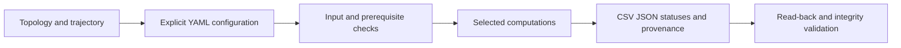

# MANIA user guide

MANIA turns an explicit molecular-analysis request into scientific CSV/JSON,
method statuses and provenance. Core is usable independently; coordinate reading
requires the optional MD runtime. This guide describes **MANIA 0.2.0**.

Start with [Quickstart](quickstart.md), then [Modes](modes.md),
[Configuration](configuration.md) and [Outputs](outputs.md). Consult
[Science](science.md) before interpreting a measurement from your own system.

| Your task | Guide |
| --- | --- |
| Install and run a synthetic tutorial outside the repository | [Quickstart](quickstart.md) |
| Inspect a plan, run, interpret exit codes | [Commands](commands.md) |
| Describe inputs, selections, time and scientific authorities | [Configuration](configuration.md) |
| Choose Basic, Custom, Full or Exploratory | [Modes](modes.md) |
| Understand formulas, populations and limitations | [Science](science.md) |
| Find, read back and validate results | [Outputs](outputs.md) |
| Select NaPi2b or understand external consumers | [Extensions](extensions.md) |
| Preserve a reproducible scientific record | [Reproducibility](reproducibility.md) |

## Useful terms

| Term | Meaning in this guide |
| --- | --- |
| Topology / trajectory | Atom/residue identities and bonds / ordered coordinate snapshots |
| RIN | Residue interaction network: residues as nodes, interactions as edges |
| Roster / population | Ordered identities / the exact observations included in a calculation |
| Mapping / reference | Explicit source-to-reference correspondence / declared residue numbering and chemistry |
| Provenance | Recorded origin, configuration, versions, identities and status of results |
| QC / replay | Quality checks under a supplied policy / reconstruction from completed saved observations |

> **Scientific warning.** A first exploratory run computes real implemented
> methods, but does not establish scientific validity. Every Exploratory run
> records `SCIENTIFIC_VALIDATION_NOT_PERFORMED` and
> `authoritative_release_eligible=false`. Basic/Custom/Full retain strict input
> requirements; their technical success also does not establish real-input
> scientific qualification, approved biology or publication readiness.

[Language gateway](../README.md) · [Repository overview](../../README.md)

---

[Guide home](README.md) · [Русский](../rus/README.md)
