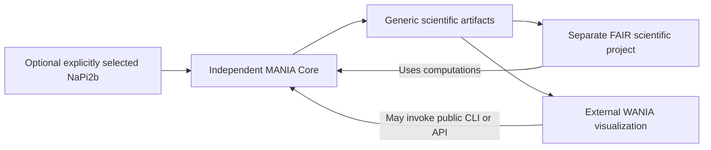

# Optional NaPi2b and external consumers

<a id="architecture"></a>
## Independent responsibilities



Core owns generic computation, QC/evidence mechanisms, provenance and artifact
validation. NaPi2b owns fixed protein-specific facts and compatibility projection.
FAIR owns actual study inputs, catalogs, grouping authority, reviewer decisions
and release policy. WANIA is external visualization. Core requires none of those
projects for generic scientific results; there is no MANIA-specific WANIA payload
command, demo contract or `mania.wania` namespace. The retained notebook CSV/JSON
converter is supported independently and does not execute `.ipynb` files.

<a id="activation"></a>
## Install separately, select explicitly

The optional package `mania-napi2b==0.2.0` requires exactly
`mania-wania==0.2.0`. After installing Core with the [Quickstart](quickstart.md#install),
keep that environment active and run this command from the full MANIA checkout root:

```sh
python -m pip install ./extensions/napi2b
```

Installation alone does **not** activate a profile. Full does not activate it.
Inactive entry-point metadata must not change Core defaults, shared numerical
dependencies or scientific outputs. Selection creates fresh scoped callables,
without mutable global registration. Profiles are `napi2b.legacy.v1` and
`napi2b.dataset.v1`; Python can select the former explicitly:

```python
from mania.extensions import load_selected_extension

profile = load_selected_extension("napi2b", "==0.2.0", "napi2b.legacy.v1")
reference = profile.reference_factories["uniprotkb:O95436-1:sequence-v3"]()
```

An explicitly selected Dataset output uses the following **partial YAML**, within
a complete valid configuration and with all supplied source files:

```yaml
extensions:
- id: napi2b
  version: '==0.2.0'
  profile: napi2b.dataset.v1
  options:
    qc_manifest_path: sources/dataset_bindings.json
    release_input_manifest_path: sources/publication_inputs.json
methods:
  profile_outputs: {}
```

The [profile.yaml](../../extensions/napi2b/examples/profile.yaml) is an
**authority-dependent template**, not a self-contained release example. Replace
SUPPLIED identities only with real authoritative records. It cannot run with
missing files. Its constructed coordinate-free test verifies source assembly,
17+3 read-back and corrupted-authority rejection, not approval of an actual study.

Core sdists include the bilingual guides and generic examples, but exclude tests and the optional extension tree. Repository-relative links to extension source/template files assume the full checkout; use the separately supplied extension source/artifacts when working only from a core sdist. No installed tutorial-resource API or automatic source discovery is provided.

<a id="biology"></a>
## Fixed reference, mapping and QC

Immutable resources preserve O95436-1 sequence version 3, **690 residues**, ECD
**234–361** and MX35 **311–341**, inclusive. The fixed sequence SHA256 is
`33ce6c59e28a7373fce51debe32cec8d891ef691c2e77a0655a74040da25eef9`;
this is separate from the generic full reference-roster digest. The resource
origin is pinned; there is no online refresh or default protein in Core.

Actual system mapping, glycosylation/disulfide/variant annotations, scientific
sources and reviewer decisions remain external. Complete fixed annotations may
make an absent site false; incomplete generic annotations retain unknown/null.
Legacy mapped-Cα RMSD requires its explicit mapping/reference and prepared lineage.
Core algorithms are reused, not copied into an extension-specific calculator.

Selected policy boundaries are 95% production coverage, >1% valid empty protein
windows for REVIEW, and strict median ±3 **raw unscaled MAD** with n=1/MAD=0
rules. They are not generic defaults. Hard FAIL cannot be overruled; REVIEW needs
a supplied authorized resolution. See [QC science](science.md#qc).

<a id="sources"></a>
## Exact source bindings

`options.qc_manifest_path` reads
`mania_napi2b.dataset_sources_bindings.v1`. Its exact fields are `schema_version`,
`kind`, `qc_sources`, `control_evidence`, `policy_evidence`, `handoffs`,
`qc_evidence_files`, `qc_decision_files`, `group_files`, `fixed_mappings`,
`canonical_sources`, `annotated_sources`, `fixed_qc_files`,
`publication_input_evidence`. `qc_sources` binds the generic QC source document.
File evidence retains exact role/path/size/SHA relative to the authority root.
The release-input path uses the retained publication-input contract.

Ordered tuples serialize as arrays: handoffs contain
`[FileEvidence, WindowInputBinding, SystemAnnotations|null, rmsd_directory|null]`;
fixed mappings contain `[InputIdentity, FileEvidence]`; canonical/annotated
sources contain `[InputIdentity, protein|lipid|glycan, FileEvidence]`.
Generic/profile policy, cohort, identities, units and metric selections must agree.
Complete supplied annotation bindings remain authoritative. Do not infer a
mapping, group, MET-0200 value, scientific metric definition or reviewer decision.
Validation/reconstruction of complete DatasetSources precedes serialization.

<a id="dataset"></a>
## Dataset-v1 compatibility boundary

The strict selected projection has **17 CSV +3 JSON**, plus the retained input
control copy. These are the fixed registry paths relative to the profile root;
they are not a universal Core output layout:

```text
aggregates/protein_edges_by_window_replica_aggregation.csv
aggregates/protein_glycan_contacts_by_window_replica_aggregation.csv
aggregates/protein_lipid_contacts_by_window_replica_aggregation.csv
canonical/nodes.csv
canonical/residue_annotations.csv
metadata/contact_definitions.csv
metadata/quality_control.csv
metadata/quality_control_evidence.csv
metadata/quality_control_findings.csv
metadata/simulations.csv
metadata/software_versions.csv
metadata/systems.csv
metadata/time_windows.csv
metrics/metrics.csv
science/protein_edges_by_window.csv
science/protein_glycan_contacts_by_window.csv
science/protein_lipid_contacts_by_window.csv
release/artifact_inventory.json
release/dataset_manifest.json
release/provenance.json
```

Projection copies authoritative upstream science; it does not calculate absent
metrics, create FAIR study catalogs or approve publication. The nested inventory
is exposed under role `profile_inventory` without renaming or rewriting its file.
Full-source lineage, compatible reference/windows/partners/QC and strict
reconstruction are required, not just the existence of 20 filenames.

<a id="preview"></a>
## Exploratory preview

With Exploratory, explicitly selected `napi2b.dataset.v1` plus `profile_outputs`
produces only a non-authoritative preview. The **same full source, mapping,
annotation, metric, QC and correspondence prerequisites** remain. Successful
preview contains 17 validated tables under `profiles/p0001/preview/tables/` and
`profiles/p0001/preview/preview_manifest.json` with schema
`mania_napi2b.dataset_exploratory_preview.v1`, source/run bindings and hashes.
A comparable complete projection preserves the same scientific table bytes.

It does not create official Dataset-v1 release manifests/provenance/seals.
Official release readers reject preview; use the selected profile preview
validator. Incomplete/failing sources and unresolved required review retain
failed/pending states without a forged completion manifest.
`SCIENTIFIC_VALIDATION_NOT_PERFORMED`, `authoritative_release_eligible=false` and
applicable unverified-PBC lineage persist. Such results cannot be scientifically
qualified authoritative FAIR release inputs.

[NaPi2b package guide](../../extensions/napi2b/README.md) ·
[Output contracts](outputs.md#qualification)

---

[Guide home](README.md) · [Русский](../rus/extensions.md)
