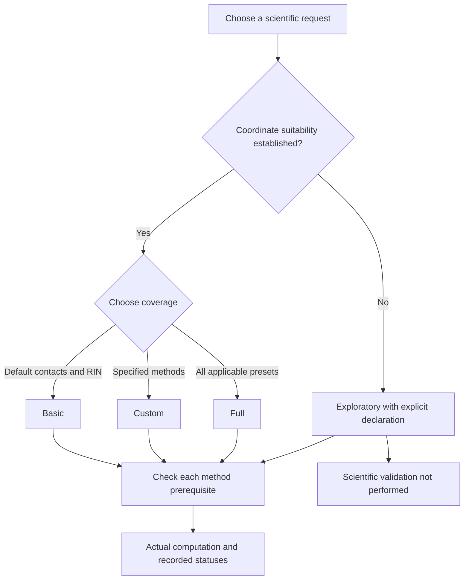

# Choosing a mode

A mode selects a request preset, not a level of scientific approval. All modes
use the same underlying methods and numerical contracts. For a first run use the
[synthetic copied-workspace tutorial](quickstart.md#copy); for your own system
establish the [scientific prerequisites](science.md).

| Capability / prerequisite | Basic | Custom | Full | Exploratory |
| --- | --- | --- | --- | --- |
| Protein heavy contacts + static RIN | Default, mandatory | Explicit or dependencies | Default, mandatory | Default; may change request |
| Automatic protein Rg after full eligibility | Conditional | No | Conditional | Disabled |
| Explicit Rg | Selection/masses/coordinate requirements | Same | Same | Selection/masses/input checks remain; unverified PBC stays unqualified |
| RMSD | Explicit fit/evaluation/reference | Same | Same | Same; legacy prepared representation still required |
| Communities / typed outputs / temporal RIN / fingerprints / PCA / clustering | Explicit | Explicit | Applicable presets | Explicit |
| Region enrichment | Explicit annotations/reference/mapping | Same | Candidate with supplied annotations | Explicit sources |
| Physical windows / lipid / glycan | Explicit time/variant/partner authorities | Same | Applicable supplied authorities | Explicit authorities |
| Comparisons / replicas | Explicit method and groups | Same | Supplied compatible groups considered | Explicit method and groups |
| QC / replay / profile outputs | Explicit source-bound request | Same | Explicit | Explicit; profile output is preview |
| Nonperiodic / prepared coordinates | Strict | Strict | Strict | Supported, still unqualified |
| `pbc.mode: unverified` | Rejected | Rejected | Rejected | Explicit declaration required |
| NaPi2b activation | Explicit installation and selection | Same | Same | Same; no official Dataset-v1 release |



<a id="basic"></a>
## Basic: contacts and static RIN

Basic selects protein contacts (`heavy`, 4.5 Å, `min_frequency: 0.0`) and static
RIN with its node metrics. These two methods cannot be disabled in Basic/Full.
Typed chemistry needed for the same graph still runs internally when separate
typed exports are not requested. A fully expanded equivalent Custom request must
preserve the same scientific graph and metrics.

Automatic Rg requires an unambiguous complete intended protein group, valid
masses/inputs and established coordinate suitability. Missing eligibility yields
an explained optional status; affirmative inapplicability is distinct from unknown.
An explicit invalid Rg is an error. The tutorial disables Rg because its partial
constructed protein is not eligibility evidence. RMSD is never automatic.

[Basic YAML](../../examples/basic.yaml) → `results-basic`. From a fresh copied
workspace, using the installed `mania` command:

```sh
mania run --config basic.yaml --dry-run
mania run --config basic.yaml
mania artifacts validate --root results-basic
```

<a id="custom"></a>
## Custom: an exact method request

Custom requires at least one explicit enabled method. Dependencies are inserted;
disabling a needed dependency is an error. Global options override the preset,
then `systems[].method_overrides` override supplied fields for that input.
Custom has no automatic Rg. Every enabled RMSD needs `fit_selection`,
`evaluation_selection` and an explicit reference.

[Custom YAML](../../examples/custom.yaml) adds fit atoms `index 0 1 2`, evaluation
atom `index 3`, and `{kind: first_selected}` to contacts/static RIN. This preserves
the accepted constructed geometry and exact RMSD checks, including the first
frame's genuine floating self-fit residual. It is not a real-protein RMSD claim.

```sh
mania run --config custom.yaml --dry-run
mania run --config custom.yaml
mania artifacts validate --root results-custom
```

<a id="full"></a>
## Full: applicable implemented families

Full adds communities, typed interaction exports, sampled-frame temporal RIN,
fingerprints, PCA, clustering, and physical/partner-window candidates. Missing
optional authority is reported as `missing_optional_input`; real degenerate
calculations retain their method-specific status. Explicit failures cannot be
silently skipped. Enrichment requires supplied annotations/reference/mapping;
physical windows require explicit physical timing and `variant_id`, and partner
methods additionally require `partners_path`. Supplied comparison/replica groups
are considered with their own matching and availability authority.

Full does not invent RMSD references, activate NaPi2b, select study QC, enable
replay/profile outputs, or implement RMSF/SASA/secondary structure. More preset
methods do not establish better scientific qualification.

[Full YAML](../../examples/full.yaml) → `results-full`. The tiny retained contact
roster has too few observations for PCA/clustering; inapplicable outputs are
honest outcomes rather than fabricated projections or labels.

```sh
mania run --config full.yaml --dry-run
mania run --config full.yaml
mania artifacts validate --root results-full
```

<a id="exploratory"></a>
## Exploratory: actual computation, unverified qualification

Default protein contacts and static RIN use the same 4.5 Å/heavy/0.0 settings.
Other supported methods require explicit requests and their scientific sources.
Automatic Rg is disabled. Explicit Rg retains selection/mass/input checks;
unverified PBC remains scientifically unestablished. Generic RMSD still needs
reference and correspondence; legacy mapped-Cα retains its prepared-input rules.
Comparisons, replicas, replay, QC and explicitly selected NaPi2b remain possible
with complete compatible sources. No internal MIC, wrap, unwrap or centering is
performed. Raw Cartesian distances may be physically unsuitable.

Only Exploratory accepts `pbc.mode: unverified` with a meaningful `declaration`;
preparation evidence cannot accompany that mode. Verified nonperiodic/prepared
inputs within Exploratory do not promote the run's scientific qualification.
An empty effective request or a disabled required dependency is rejected.

[Exploratory YAML](../../examples/exploratory.yaml) → `results-exploratory`.
Its deliberate unverified declaration demonstrates both warning codes:

```sh
mania run --config exploratory.yaml --dry-run
mania run --config exploratory.yaml
mania artifacts validate --root results-exploratory
```

Every outcome retains `SCIENTIFIC_VALIDATION_NOT_PERFORMED`,
`authoritative_release_eligible=false` and, when applicable, `PBC_UNVERIFIED`.
These records survive technical success, QC PASS, failure, cancellation and
read-back. Exploratory results cannot supply scientifically qualified
authoritative FAIR release inputs. Selected NaPi2b produces only a preliminary
[preview](extensions.md#preview), without an official Dataset-v1 release seal.
Basic/Custom/Full remain strict; Exploratory is not a shortcut to approval.

---

[Guide home](README.md) · [Русский](../rus/modes.md)
