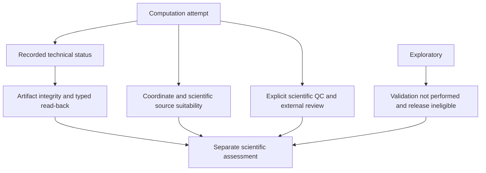

# Practical reproducibility

## Preserve the scientific request and its sources

A reproducible result needs more than the command line. Keep the original
read-only inputs and the exact YAML, input identities, topology/atom order,
trajectory order, selected source frames, actual times, PBC declaration and
external preparation evidence. Keep explicit reference/mapping/annotation,
partner, matching, replica and QC/review sources with their provenance and rights.
Do not reconstruct these facts from a result folder name.

| Record | What it establishes / does not establish |
| --- | --- |
| Input/source byte size and SHA256 | Exact bound file bytes; not physical correctness |
| Effective config and method parameters | What the run requested and actually resolved |
| Frame/time/atom/reference rosters and digests | Exact measured population and scientific correspondence |
| Runtime/software/dependency identity | Numerical environment used, not universal cross-runtime equality |
| Completed observations and statuses | Actual computed, missing, failed and pending outcomes |
| Supplied policy and reviewer evidence | Actual authority and decisions, never invented approval |

Output provenance/inventory records these roles without overwriting the original
sources. `checksum_mode: sha256` requests full configured-input hashing; cost that
I/O for large inputs. `none` does not waive mandatory reference/authority hashes.
Dry-run does not hash a huge trajectory or establish full frame compatibility.

## Preserve the installed numerical environment

The ordinary pip installation in [Quickstart](quickstart.md#install) is for getting
started. Rigorous numerical reproduction needs a recorded and controlled environment.
Record Python version/build, `mania-wania` version, selected extension versions,
NumPy, SciPy, MDAnalysis, BLAS and other dependency artifacts/versions/hashes.
Keep the same inputs,
options, ordering, source decisions, BLAS and thread settings for exact comparisons.
There is no promise of byte-exact SVD or floating results across different Python,
BLAS, platform or dependency versions. Do not add numerical tolerances or change
rounding to hide an unexplained difference.

Python >=3.11 metadata is not proof of a qualified environment. When strict
reproducibility requires it, retain a complete dependency lock for the chosen
runtime and a wheelhouse of original artifacts verified by hashes. These are
optional controls for that workflow, not bundled beginner prerequisites. Record
how the environment was resolved and installed; a list of a few versions is not
a complete lock. Base remains usable without MDAnalysis. Installing an
inactive NaPi2b wheel must not change Core scientific outputs or dependencies.
Selected profile projections are recorded separately.

For package behavior, use a regular installed wheel with isolated Python from an
unrelated cwd. `python -I -B -m mania` excludes ordinary source/PYTHONPATH fallback
and bytecode writes. An editable import or a successful syntax check does not
establish ordinary installed execution. Source sdists include user docs/examples;
wheels expose installed package APIs, not a tutorial-resource API. Tests and
private development material are outside the ordinary package contract.

## Read back and retain actual outcomes

1. Inspect `summary.json` and every requested method's status/reason.
2. Validate the explicit root with `mania artifacts validate --root /path/to/result`.
3. Preserve effective config, plan, runtime, provenance, inventory and all scientific files together.
4. Keep observation/completion/plan sources when replay or downstream aggregation is needed.
5. Check reference/window/partner/availability authority before combining replicas or conditions.

Typed read-back checks identities, schemas, scientific structures and applicable
hashes. It can establish the integrity of an honestly failed run; it does not
promote the run status. Missing frames stay missing; null statistics are not zero;
unavailable replicas do not become available negatives. A detached CSV cannot
establish the source's completeness or scientific qualification. No automatic
resume or implicit output overwrite is supported. Repeat in a new independent
workspace when reproducing the tutorial.

## Technical success and scientific qualification

**Integrity**, **QC** and **scientific approval** are separate. Good checksums do
not prove suitable PBC. A QC PASS does not approve biology or publication.
Exploratory retains `SCIENTIFIC_VALIDATION_NOT_PERFORMED`,
`authoritative_release_eligible=false` and applicable `PBC_UNVERIFIED` even with
technical success, prepared direct inputs or a passing selected policy. Strict
consumers refuse those upstreams as authoritative evidence; Exploratory consumers
must preserve their inherited qualification. A NaPi2b preview is not Dataset-v1
release approval.

## Limits of present evidence

The bundled two-model/four-atom PDB and constructed source-chain tests verify
implemented formulas, exact source-API parity, validation, negative behavior and
small installed workflows. They do not establish real TPR/XTC or PSF/DCD scientific
suitability, large-system performance, biological interpretation, approved PBC
preparation or publication readiness. A terminal percentage and successful
technical exit have the same limitation.

Routine technical checks use tiny/constructed or fake-runtime cases. Heavy
local MD is local-only, not required by default CI, and needs separately authorized
inputs and scientific acceptance. Remote CI configuration is not remote execution.

**Real-input scientific qualification remains incomplete.** It requires
separately authorized actual inputs, coordinate/time/selection/source authority,
compatible runtime and scientific comparison/reviewer evidence. No tutorial,
configuration of remote CI or historical receipt substitutes for those checks.
Record actual failures and classify unavailable checks as NOT RUN/BLOCKED, never
PASS. This public source snapshot computes RMSF/SASA; see
[settings](configuration.md#rmsf-sasa) and [definitions](science.md#rmsf-sasa).
Package metadata remains 0.2.0; record the public Git commit for reproducibility.
Source publication and technical verification do not establish scientific
qualification for each intended real input and use. Secondary structure, internal PBC
preparation, scientific-constants files and automatic sensitivity analysis remain
outside the implemented capability set.

[Scientific definitions](science.md) · [Output interpretation](outputs.md)

---

[Guide home](README.md) · [Русский](../rus/reproducibility.md)
