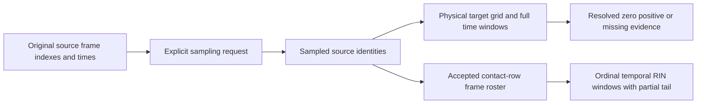

# Scientific reference

The definitions below describe implemented behavior, not scientific approval of a particular trajectory. Units, populations and missing-data rules are part of each method. [Configuration](configuration.md) lists the supported parameter surface; [Outputs](outputs.md) explains serializers and read-back.

**Navigate:** [Trajectory readers and source identity](#readers) · [Source frames and observed time](#frames) · [Physical sampling and two window mechanisms](#time-windows) · [Coordinate suitability and PBC](#pbc) · [Protein contacts and backbone](#contacts) · [Typed interaction chemistry](#chemistry) · [Protein–lipid and protein–glycan contacts](#partners) · [Frequency, occupancy and distance populations](#frequencies) · [Episodes and lifetimes](#episodes) · [Per-frame observations and replay](#replay) · [Radius of gyration](#rg) · [RMSD: separate fit and evaluation](#rmsd) · [Static RIN and graph semantics](#static-rin) · [Centralities and network metrics](#centralities) · [Communities and supplied-region enrichment](#communities) · [Temporal RIN and window metrics](#temporal-rin) · [Contact fingerprints](#fingerprints) · [PCA of interaction fingerprints](#pca) · [Deterministic clustering](#clustering) · [Matched comparisons and paired statistics](#comparisons) · [Reference, mapping and annotations](#reference) · [Scientific window-table projection](#projection) · [Replica aggregation](#replicas) · [QC, raw MAD and scientific policies](#qc) · [Handoff, provenance and limitations](#handoff)

<a id="readers"></a>
## Trajectory readers and source identity

Use a compatible topology and ordered coordinate files to establish atom/residue
identity and the source frame axis. The initial supported real-input families are
GROMACS TPR/XTC and NAMD PSF/DCD through optional MDAnalysis==2.10.0. The bundled
PDB is a constructed tutorial of the generic loader, not qualification of an
additional real-input workflow. Readers preserve ordering and close on error.
Loading does not infer biological mapping, preparation or physical suitability.

NAMD requires one bound DCD plus explicit element/time authority. PSF type keys
must match accepted CHARMM element definitions or supplied reviewed assignments;
elements are not inferred from masses or atom names. Time binds config/log literal
controls to the DCD header/count/source. Missing/conflicting controls block the
coordinate method. There is no directory-based time inference.

NAMD write steps are `range(firsttimestep + dcdfreq, numsteps + 1, dcdfreq)`;
`time_ps(step) = Decimal(step)*Decimal(timestep_fs)/1000`. These assign source
time, not coordinates. Coordinate distances are in Å; retained times are in ps.
Scientific identity is the explicit composite input key, not a path or condition
label. Invalid/unreadable inputs yield failure evidence, not zero measurements.

Implementation: [trajectory loader](../../src/mania/preprocessing/trajectory_loader.py),
[NAMD authority](../../src/mania/preprocessing/namd_authority.py).

<a id="frames"></a>
## Source frames and observed time

Sampling preserves zero-based **source** indexes. Defaults are start 0, stride 1,
no stop and no maximum. `start` is inclusive, `stop` exclusive, stride is anchored
at start, and explicit `max_frames` limits the selected count. Exact-index requests
must be increasing and unique; competing selectors are rejected. A result-row
number does not replace a source index; missing requested frames are not invented.

Legacy contact time prefers usable `timestep.time`, with explicit
`source_index*frame_time_ps` only as fallback. Legacy all-group Rg instead lets an
explicit `frame_time_ps` override timestep time. The new physical/NAMD pathways
retain their own authoritative time assignment. These Python/API contracts must
not be replaced by one supposed universal time precedence.

Observed contact/Rg frame rosters must agree. Compatible known times use the
symmetric representative `min(contact_time, rg_time)` with existing
`isclose(rel_tol=1e-9, abs_tol=1e-9 ps)`; a lone known time is retained. Uniform
spacing requires >=2 known times and positive consistent differences; spacing is
`fsum(differences)/Ndiff`. Missing/too few times yield unavailable spacing; known
nonuniform times yield `non_uniform`, without interpolation.

Implementation: [frame sampling](../../src/mania/preprocessing/trajectory_frame_sampling.py),
[provenance](../../src/mania/run_provenance.py).

<a id="time-windows"></a>
## Physical sampling and two window mechanisms

Physical sampling builds a closed target grid from Decimal string values:
`t_k = 1000*production_start_ns + k*frame_stride_ps` while
`t_k <= 1000*production_end_ns`. A target needs one unique source match under the
existing `isclose(rel_tol=1e-9, abs_tol=1e-6 ps)`. No snapping, clamping, nearest
choice or source-frame reuse resolves ambiguity. Missing targets remain records;
coverage is resolved/requested. Effective stride is available only for a complete
consecutive resolved grid with >=2 samples. A physical request needs no windows.

| Mechanism | Membership, denominator and boundary |
| --- | --- |
| Physical windows | Decimal starts `start_j=start+j*step`, `end_j=start_j+length <= production_end`; only full windows; membership uses **requested** time, metrics use actual resolved observations |
| `mania.window_boundaries.legacy.v1` | `[start,end)`, except a window ending exactly at production end includes that end |
| `mania.window_boundaries.inclusive.v1` | Both ends included for every window |
| Sampled-frame temporal RIN | Slices sorted unique frame indexes from accepted contact rows by ordinal position; defaults 10 frames / step 10 / frequency 0.25; final reached nonempty partial window allowed |

Physical `0 < step <= length`, overlap is `100*(1-step/length)` in [0,100),
checked with the existing relative 1e-9 / absolute 1e-6 percentage-point rule.
Overlapping windows deliberately reuse membership across windows. No full window
or no resolved window observations is not a valid complete zero result.



A header-only legacy contact CSV supplies no sampled roster; it does not prove an
all-zero trajectory. Physical coverage sidecars and completion observations have
a richer zero/missing contract. Do not interchange these two mechanisms.

Implementation: [physical sampling](../../src/mania/preprocessing/physical_time_sampling.py),
[physical windows](../../src/mania/preprocessing/physical_time_windows.py),
[temporal RIN windows](../../src/mania/analysis/temporal_rin_windows.py).

<a id="pbc"></a>
## Coordinate suitability and PBC

Strict Basic/Custom/Full use declared nonperiodic or externally prepared
coordinates with relevant source-bound evidence. Prepared is not a scientific
verdict: the intended complete protein must have a suitable unbroken
representation for the actual operation. Nonzero cell metadata contradicts a
nonperiodic declaration. Box metadata alone does not establish suitability.

There is no internal MIC, wrap, unwrap, centering or coordinate mutation.
Cartesian distances across a periodic boundary can therefore be physically wrong.
Exploratory can explicitly declare unverified PBC, preserving every other method
prerequisite and marking the result unqualified. Automatic Rg is disabled there;
explicit Rg may run with independently valid selection/masses/inputs while its
PBC qualification remains unestablished. Legacy mapped-Cα still needs its accepted
prepared representation. Existing observation tolerances describe observations,
not a new scientific adequacy threshold.

See [PBC configuration](configuration.md#pbc) and
[qualification](reproducibility.md#qualification).

<a id="contacts"></a>
## Protein contacts and backbone

Purpose: identify residue pairs that approach in selected coordinates. The run
preset selects protein heavy atoms; explicit `selection: all` is a distinct
population. `residue_index` is topology-local; `resid`, resname and segment identity
remain separate. Self-pairs and duplicate unordered pairs are excluded.

For distinct residues A and B, `d_min(A,B)=min ||r_a-r_b||` over selected atom pairs;
`residue_contact` holds when `d_min <= cutoff_distance`, default **4.5 Å**.
The retained general heavy filter excludes element H or its legacy H-name fallback;
typed chemistry and strict partner heavy authority have their own rules.
Missing coordinates/empty atom representation are issues, never zero distances.

Backbone is separate: protein-selection topology indexes `j=i+1`, same `segid`,
CA coordinates present and `d(CA_i,CA_j) <= 4.5 Å`. Numeric residue-number adjacency
is not the rule. Representative CA coordinates retain their observed frame
origin; they are not time-averaged structures.

Python computation limits default to None (unlimited), not a hidden frame/pair
cap. Explicit pair/distance-evaluation limits reject strictly exceeded frames
before chemistry; equality is allowed. They do not truncate the population.
A rejected empty frame is failed evidence, not a measured negative frame.

Implementation: [contacts](../../src/mania/preprocessing/trajectory_contacts.py),
[chemistry](../../src/mania/preprocessing/trajectory_contact_chemistry.py).

<a id="chemistry"></a>
## Typed interaction chemistry

| Type | Implemented geometry (Å unless stated) |
| --- | --- |
| `hbond` | D–A <= 3.5; supplied donor–H bond; D–H–A >= 120°; named N/O donor/acceptor rule |
| `disulfide` | CYS SG–SG <= 2.2 |
| `salt_bridge` | LYS NZ / ARG NH1,NH2 against ASP OD1,OD2 / GLU OE1,OE2; minimum <= 4.0 |
| `ionic` | Same negative atoms; positive LYS/ARG plus HIS/HID/HIE/HIP ND1,NE2; minimum <= 6.0 |
| `hydrophobic` | CB–CB <= 5.0 for ALA,VAL,ILE,LEU,MET,PHE,TRP,PRO,TYR; no CA fallback |
| `vdw` | 3.0 <= minimum heavy-atom distance <= 4.5 |
| `aromatic_pi` | Complete named rings; centroid distance <= 7.0; normal angle < 30° or 60°–120° inclusive |
| `cation_pi` | LYS NZ or ARG CZ to ring centroid **strictly < 6.0** |

These geometric labels describe the implemented named-atom rules, not an inferred
protonation state or experimental proof of a chemical bond. Types can coexist.
H-bonds require explicit topology-bound hydrogen; none is reconstructed. Among
qualifying observations the shortest D–A distance is retained. Degenerate angular
vectors (magnitude <=1e-12) yield no angle/contact, not guessed geometry.

Ring rosters: PHE/TYR `CG CD1 CD2 CE1 CE2 CZ`; TRP
`CG CD1 CD2 NE1 CE2 CE3 CZ2 CZ3 CH2`; HIS/HID/HIE/HIP
`CG ND1 CD2 CE1 NE2`. The centroid is the arithmetic mean; the normal is the
smallest-eigenvalue vector of the coordinate scatter matrix, using the retained
3×3 Jacobi algorithm (32 iterations, geometry tolerance 1e-12). Missing, incomplete
or collinear rings give no usable normal. The normal angle uses `abs(dot(n1,n2))`,
so is acute (<=90°); the stated 60°–120° branch effectively reaches 90°. Exactly
30° is not parallel, and exactly 6 Å is not cation–π. No library replacement or
configurable chemistry-threshold surface is implied.

Implementation: [chemical atom tables](../../src/mania/preprocessing/trajectory_contact_chemistry.py),
[interaction geometry](../../src/mania/preprocessing/trajectory_interaction_geometry.py).

<a id="partners"></a>
## Protein–lipid and protein–glycan contacts

Purpose: measure a protein residue's proximity to a complete declared molecular
partner. Component identity/kind, atom membership, connectivity and glycan carrier
linkage come from supplied metadata/topology; there is no universal lipid/glycan
name registry. Local partner IDs are not cross-replica equivalence.

The minimum Cartesian heavy-atom distance to the **whole partner** defines a
contact: lipid **<=6.0 Å**, glycan **<=4.5 Å**. Explicit authoritative elements or
atomic numbers (1..118, mutually consistent) establish heavy atoms; guessed
metadata is discarded. Invalid heavy representation fails even with no lipids.
Bounding-box rejection accelerates the same exact cutoff geometry and must not
remove genuinely close pairs.

A verified protein-carrier/first-sugar linkage positive remains in raw evidence as
`standard_summary_excluded=True` with its covalent-linkage reason. It is excluded
from ordinary occupancy, episodes and distances, not converted into a negative
or used to remove unrelated carrier contacts. Missing/contradictory linkage fails.
No partners yields an empty applicable-domain result; unknown partners are not
proven absent. Per-frame and window identities must stay consistent.

Implementation: [lipids](../../src/mania/preprocessing/protein_lipid_contacts.py),
[glycans](../../src/mania/preprocessing/protein_glycan_contacts.py).

<a id="frequencies"></a>
## Frequency, occupancy and distance populations

Purpose: summarize contact persistence and proximity without confusing distinct
observation populations. Frequencies/occupancies are dimensionless [0,1];
distances and their SD are Å.

| Output family | Numerator / denominator and distance population |
| --- | --- |
| InteractionAccumulator / protein typed aggregates | Unique positive frame count / supplied sampled frame count; distance mean and population SD count every retained add occurrence |
| Legacy `contact_edges.csv` | One minimum per pair/type/included frame; positive frame count / included frames; default excludes failed frames |
| Graph export | Always excludes failed frames; simplifies by primary type with that type's statistics |
| Physical-window occupancy | Positive contact frames / all **resolved** window frames with completed computation evidence, including proven negatives; missing requested frames excluded |
| Partner-window distance | Mean/minimum of per-frame minima for ordinary positive contacts only; covalent-excluded raw glycan positives remain separate |

Accumulator formulas: `f=|unique positive frames|/Nsampled`,
`mean_d=sum(d)/Noccurrence`, `SD_d=sqrt(sum((d-mean_d)^2)/Noccurrence)`.
One distance has population SD 0. The accumulator's `min_frequency` filter retains
equality (`f >= threshold`, default 0.0); legacy CSV/graph aggregation is separate
and does not apply this accumulator filter. CSV's explicit
`include_failed_frames=True` changes its included denominator and keeps supplied
contacts/issues; it does not establish those frames' scientific success.

Physical sparse rows exist for positive pair/type/window observations. Their
occupancy denominator is resolved frames, while `coverage_fraction=resolved/requested`
describes coverage separately. A complete available window lacking an edge can
support a private zero in aggregation; an absent sparse row alone proves nothing.
Failed plans or incomplete resolved-frame computation prohibit faithful aggregation.
No observations with denominator zero produce no invented contact frequency.

Implementation: [accumulator](../../src/mania/preprocessing/trajectory_contact_accumulator.py),
[physical protein windows](../../src/mania/preprocessing/protein_edge_windows.py).

<a id="episodes"></a>
## Episodes and lifetimes

Purpose: distinguish sustained contact from intermittent positives. An episode
is a maximal run of positive **requested sample positions**. A resolved negative
or missing requested position breaks it. Numeric source-index gaps do not break
it when successive requested positions remain consecutive. Each window and
replica is independent, including overlapping windows.

`length_ns=(last_actual_time_ps-first_actual_time_ps)/1000`; a singleton is **0 ns**.
Mean/max use these episode lengths; no extra stride is added. Gap tolerance is
exactly **0 frames**. With no positive contact, episode count is 0 and mean/max
length are null. Requested continuity does not authorize interpolation.
Legacy placeholder lifetime/window-CV columns are not these computed physical
window metrics and must not be populated by assumption.

Implementation: [episodes](../../src/mania/preprocessing/contact_episodes.py).

<a id="replay"></a>
## Per-frame observations and replay

Purpose: reconstruct accepted window summaries without reopening coordinates.
Physical observation artifacts record source/requested frame identities, actual
time, positive contacts, completed zeros, missing/failed states and completion.
Replay first checks the exact roster, identities, completion and SHA256 bindings,
then invokes the same window aggregation rules without rematching physical time.
An empty CSV without completion is not a measured zero trajectory. Stale,
incomplete or changed evidence blocks faithful reconstruction.

Request `replay` with `completion_path` and `execution_plan_path`. Retained typed
contact CSV/fingerprint exports use their distinct accepted-row population;
they must not impersonate richer physical completion evidence. Technical subset
markers cannot establish full scientific handoff completeness.

Implementation: [observations](../../src/mania/preprocessing/perframe_observations.py),
[replay](../../src/mania/preprocessing/window_replay.py).

<a id="rg"></a>
## Radius of gyration

Purpose: quantify the spatial spread of an explicitly established atom group
around its mass-weighted center. The implementation calls the existing selected
MDAnalysis `AtomGroup.radius_of_gyration()` without transformation arguments.
Result unit is **Å**; different atom populations are different measurements.

`M=sum(m_i)`, `r_COM=sum(m_i*r_i)/M`,
`Rg=sqrt(sum(m_i*||r_i-r_COM||^2)/M)`.

Basic/Full automatic protein Rg requires all three: unambiguous complete intended
protein group/chains, valid masses/finite data, and suitable coordinate evidence.
A nonempty `protein` selection is insufficient. FASTA/mapping is not required
when topology already establishes the group. Unknown eligibility is an explained
optional non-completion; explicit invalid requests fail. After eligibility,
a runtime calculation failure stays failed. `include_failed_frames: true` retains
diagnostic rows, not successful measurements.

Legacy all-loaded-system Rg remains a distinct Python API and does not silently
become protein/heavy Rg. Missing/nonfinite/negative results stay failed/null.
Exploratory never enables automatic Rg; explicit unverified-PBC output remains
unqualified even with valid other prerequisites.

The current generic run controller establishes automatic protein identity from the explicit molecular roster and checks unguessed positive masses. Its Rg PBC observation establishes the declared nonperiodic case with an absent/zero cell; prepared-coordinate Rg suitability remains unestablished in that controller. Therefore a prepared declaration/evidence path alone cannot enable strict Rg: automatic requests can skip and explicit requests can fail. This conservative admission does not perform or approve coordinate preparation.

Implementation: [Rg](../../src/mania/preprocessing/trajectory_rg.py),
[selected-group execution](../../src/mania/preprocessing/run_execution.py).

<a id="rmsd"></a>
## RMSD: separate fit and evaluation

Purpose: measure displacement of selected evaluation atoms after a proper rigid
alignment fitted solely to selected fit atoms. All coordinates/operations are
equal-weight float64; result unit **Å**. Row-vector equations:

```text
muX = mean(Xfit); muY = mean(Yfit)
U, S, Vt = svd((Xfit-muX).T @ (Yfit-muY))
D = diag(1, 1, +1 if det(U @ Vt) >= 0 else -1)
R = U @ D @ Vt
Ealigned = (Xevaluation-muX) @ R + muY
RMSD = sqrt(sum(||Ealigned_i-Yevaluation_i||^2) / Nevaluation)
```

No reflection or independent evaluation refit/recentering is performed. Fit needs
>=3 finite correctly corresponding noncollinear atoms (NumPy matrix rank >=2);
evaluation needs >=1 finite atom, without a separate rank requirement. Empty,
ambiguous, reordered or inconsistent correspondences fail. Reference must be
explicit `first_selected` or external coordinates plus strict atom mapping.
The first frame can retain a small actual floating self-fit residual; no rounding
to an assumed zero or new tolerance is justified. RMSD serializer uses `.17g`.

Legacy selected NaPi2b mapped-Cα RMSD has a separate same-set API: one C-element
CA per explicitly mapped residue, canonical ordering, fixed reference/roster,
prepared lineage and first resolved production sample as reference. Missing
requested samples retain nulls; a callback cannot silently redefine the reference.
Neither RMSD path invents a drift threshold or biological interpretation.

Implementation: [RMSD](../../src/mania/preprocessing/trajectory_rmsd.py),
[external reference readers](../../src/mania/result_readers.py).

<a id="static-rin"></a>
## Static RIN and graph semantics

Purpose: describe residue interaction topology. The static RIN is an undirected
simple graph: residues are nodes and normalized residue pairs are edges. It may
retain isolated roster nodes. Multiple types on one pair are retained, with the
lowest-priority-rank type as primary. The retained constant is `EDGE_TYPE_PRIORITY`. Priority is:

`backbone → hbond → disulfide → salt_bridge → ionic → cation_pi → aromatic_pi → hydrophobic → vdw → residue_contact`

Edge weight/contact frequency comes from that **primary** interaction, not a sum,
maximum or union of coexisting type frequencies. `all_edge_types` and
`n_edge_types` retain the other types. Missing weights stay null. Self-loops,
duplicates and inconsistent source identity fail validation.

Legacy `ContractGraph` is a separate API: edge-row counts, typed duplicates,
reversed rows and self-loop handling retain their own adjacency/strength semantics.
The strict topology parser rejects invalid weights; separate legacy analysis
records a 0.0 fallback for missing/non-numeric weights. This does not turn missing
scientific observations into a measured zero. Do not compare these graph families
as though their node/edge populations and defaults were identical.

Implementation: [static RIN](../../src/mania/analysis/static_rin_graph.py),
[legacy graph](../../src/mania/analysis/contract_graph.py).

<a id="centralities"></a>
## Centralities and network metrics

| Metric | Static-RIN implementation / interpretation |
| --- | --- |
| Degree | `degree_i = number of neighbors`; topological connectivity |
| Strength | `fsum(non-null incident weights)`; isolate 0, incident edges all missing weights → null |
| Betweenness | Unweighted Brandes ordered-source dependencies; divide by `(n-1)*(n-2)` for n>2; participation in shortest paths |
| Closeness | `(reachable/sum_distances)*(reachable/(n-1))`, otherwise 0; disconnected nodes penalized |
| Eigenvector | Iterate `x = (I+A)x / norm((I+A)x)`; influence from unweighted neighbors |
| PageRank | `(1-d)/n + d*dangling_mass/n + d*sum(x_j/degree_j)`; d=0.85 |
| K-core | Remove smallest remaining degree with deterministic ties; current core is max(previous core, removed degree) |

Except strength, these centralities are **unweighted**; contact frequency is not
a path length. Traversal/order and `fsum` preserve the source implementation.
Eigenvector uses max 5000 iterations and tolerance 1e-12; PageRank max 1000 and
1e-12. Both stop at strict L1 change `< n*tolerance`, starting from 1/n.
An iterative arithmetic/convergence failure yields null for all affected nodes,
not invented zeros. Small/edgeless/disconnected graphs retain source definitions.

Legacy general `graph_metrics` has different defaults: eigenvector 5000/1e-6,
PageRank 100/1e-6 and its own edge handling/order. These are not interchangeable
precision settings. Metrics have count/dimensionless units, not Å or energy.
Topology QC (components, isolates, loops, duplicates) describes a graph, not the
physical quality of MD. Consistency checks compare exported degree/strength using
their retained absolute 1e-6 diagnostic threshold; this is not scientific approval.

Implementation: [static metrics](../../src/mania/analysis/static_rin_metrics.py),
[legacy metrics](../../src/mania/analysis/graph_metrics.py),
[consistency](../../src/mania/analysis/graph_consistency.py).

<a id="communities"></a>
## Communities and supplied-region enrichment

Purpose: find topological modules and test supplied region-label composition.
Communities use deterministic **greedy modularity**, not Louvain. Starting from
singletons, the custom algorithm merges connected community pairs with positive
gain >1e-12, using deterministic member-order ties. Unweighted modularity is
`Q=sum_c[L_c/m-(K_c/(2*m))^2]` and
`deltaQ=e_ab/m-K_a*K_b/(2*m^2)`. Here m is edge count, L internal edge count,
K degree sum, e_ab inter-community edge count. An edgeless graph yields singleton
communities and Q=0. Community IDs start at 1 and are condition-local, not
cross-system biological correspondence. Recorded legacy seeds do not make the
actual greedy algorithm randomized.

Enrichment uses **labeled graph nodes only**. For a community/region, a=region
inside, b=other labeled inside, c=region outside, d=other labeled outside.
`P(x)=comb(a+c,x)*comb(b+d,a+b-x)/comb(a+b+c+d,a+b)`;
two-sided Fisher sums probabilities whose exact integer numerator is <= the
observed numerator, bounded by 1. It is not a doubled-tail approximation.
Odds ratio `a*d/(b*c)` is null when `b*c=0`, not infinity.

At least two communities, two regions and nonempty required margins are needed.
Missing labels/insufficient groups produce explicit skipped rows. Unlabeled nodes
are excluded; regions are never inferred. The implemented exact Fisher p-value
has no added multiple-testing correction or confidence interval; it does not
supply the unavailable p-values of the separate comparison method.

Implementation: [communities](../../src/mania/analysis/static_rin_communities.py),
[enrichment](../../src/mania/analysis/static_rin_region_enrichment.py).

<a id="temporal-rin"></a>
## Temporal RIN and window metrics

Purpose: follow accepted interaction topology over sampled-frame windows.
For sorted unique accepted source indexes F, window k is
`F[k*step_size : k*step_size+window_size]`. The frame start/end fields are the
first/last source indexes, both descriptive endpoints inclusive. Defaults are
10/10 frames and `min_frequency: 0.25`; final nonempty partial windows are allowed.
Per-type frequency is unique positive frames / that window's sampled frame count
(`sampled_frame_count`);
`window_contact_freq >= min_frequency` retains equality. Primary types follow
the static graph priority. Distance
mean/population SD/min/max use available typed distances (`fmean`/`pstdev`).

The separate metrics operation uses **active nodes incident to passing edges**,
not the full topology roster. `density=2*m/(n*(n-1))`,
`mean_degree=fsum(degrees)/n`, and mean strength requires all node strengths known.
Betweenness mean/max, closeness mean, modularity and community count use the same
static unweighted methods. Empty/no-passing/no-node/no-edge outcomes retain counts
but null network summary metrics, not invented zero density or communities.
`active_frame_count` describes frames with accepted rows before threshold filtering.

A builder, metrics API and writer are separate operations. Source frames absent
from the accepted-row CSV are not recovered from a numeric range. This is why the
Full tutorial's two-model trajectory can provide only one fingerprint observation.

Implementation: [windows](../../src/mania/analysis/temporal_rin_windows.py),
[metrics](../../src/mania/analysis/temporal_rin_metrics.py).

<a id="fingerprints"></a>
## Contact fingerprints

Purpose: encode interaction-state differences as a binary matrix. Rows are the
explicit accepted sampled frame roster; features are the union of normalized
residue-pair + edge-type observations. `X[t,f]=1` if observed, otherwise 0 within
this validated matrix. Ordering follows source endpoints and interaction priority;
features are not atom pairs or continuous distances. Values are dimensionless 0/1,
without scaling or normalization.

A truly missing physical observation cannot be imputed as a zero matrix row.
Duplicate frame/pair/type or contradictory row times fail. Empty roster and zero
features have distinct statuses. All-zero accepted frames without row time retain
null time. Fingerprint construction does not itself perform PCA or modify RIN.

The retained Python analysis input name `contacts_perframe_{condition}.csv`
remains separate from the unified controller artifact `protein_contacts_perframe.csv`.
Neither fingerprint construction nor temporal-RIN export depends on an external
visualization application.

Implementation: [fingerprints](../../src/mania/analysis/contact_fingerprints.py).

<a id="pca"></a>
## PCA of interaction fingerprints

Purpose: find dominant variation directions in **contact features**, not aligned
Cartesian coordinates. PCA centers columns without variance scaling or whitening:

```text
Xc = X - mean_columns(X)
U, S, Vt = svd(Xc, full_matrices=False)       # float64
rank_tolerance = max(n_frames, n_features) * eps_float64 * S[0]
rank = count(S > rank_tolerance)
k = min(max_components, n_frames-1, n_features, rank)
scores = U[:, :k] * S[:k]
explained_variance_ratio[j] = S[j]^2 / sum_all(S^2)
```

Default `max_components=10`. A loading's first maximum-absolute-value pivot sets
the sign; a negative pivot flips both loading and score. Internal projections can
contain >3 components, while CSV exports at most the first three. Scores and
variance ratios are dimensionless; interpretation depends on the actual features.

Empty input, no features, one frame, constant matrix, unavailable runtime and
numerical failure retain distinct statuses/null components. No arbitrary component
is invented for a degenerate matrix. Exact SVD comparisons need the same runtime;
repeated-singular-value subspaces do not authorize silent equivalence tolerances.
PCA output normalizes computed signed zero to positive zero and uses `.15g` CSV;
that rule is not a global serializer policy.

Implementation: [PCA](../../src/mania/analysis/conformation_pca.py).

<a id="clustering"></a>
## Deterministic clustering

Purpose: group frames with similar fingerprints or explicitly computed PCA
coordinates. The custom deterministic k-means uses squared Euclidean distances,
arithmetic centroids and unchanged assignments for convergence. Initialization
chooses the lexically first vector (source-frame tie), then farthest-first vectors;
assignment ties choose the lowest cluster index. No random/scikit-learn replacement
is used. This does not claim notebook PCA-to-k-means parity or full statistical
notebook parity.

Candidates are `k=2..min(max_k,n_frames-1)` inclusive, default `max_k=10`,
`max_iterations=100`, requiring >=3 frames. For frame i, a_i is mean Euclidean
distance to other own-cluster members, b_i the smallest mean to another cluster;
`s_i=(b_i-a_i)/max(a_i,b_i)`, singleton/zero denominator →0. Overall silhouette
is `fsum(s_i)/N`; highest score wins, equal scores retain lower k.

States are ordered by earliest source frame and numbered from 1. Representative
minimizes squared centroid distance then source index. The exported
**`distance_to_centroid` is squared distance**, despite its short field name.
Fingerprint/PCA basis and selected component count are recorded. PCA basis can
use internal components above the three CSV columns; without internal scores,
the validated exported fallback cannot invent additional components.

Empty clusters invalidate a candidate; reaching the iteration limit may retain
a valid candidate with `converged=False`. Empty/no-feature/<3-frame/constant/no-valid-k
inputs have explicit non-computed outcomes. No inertia, DB/CH metrics, statistical
significance or biologically named state is invented.

Implementation: [clustering](../../src/mania/analysis/conformation_clustering.py).

<a id="comparisons"></a>
## Matched comparisons and paired statistics

Purpose: compare node metrics across explicitly matched inputs. New matching
uses a common declared reference with verified source/reference identities and
nonmatched reasons. Numeric residue-number equality is not a mapping. The new
matching-v1 comparison/statistics formats have 64/62 columns; retained legacy
Python comparison CSV remains a distinct format and population contract.

For complete metric pairs `delta_i=B_i-A_i`;
`mean_delta=fsum(delta_i)/N`; sample variance
`fsum((delta_i-mean_delta)^2)/(N-1)`; `Cohen_dz=mean_delta/sqrt(sample_variance)`.
Mean needs >=1 pair; dz needs >=2 and nonzero variance. Only complete pairs enter
these vectors. Missing metrics/unmatched identities are counted separately;
identity conflict blocks the affected paired statistic. Do not substitute zeros.

Delta keeps the metric's unit; dz is dimensionless. Source ordering, both original
identities and reason fields remain in the new outputs. Comparison p/q-values,
confidence intervals and edge/community/enrichment comparisons are not implemented;
the corresponding unsupported/null fields are not significance results.

Implementation: [comparison](../../src/mania/analysis/static_rin_comparison.py).

<a id="reference"></a>
## Reference, mapping and annotations

Purpose: relate source residue identities to explicit reference positions without
altering the measured science. Generic `mania.reference.v1` has a supplied ID,
ordered chains, positions, amino-acid symbols and declared residue chemistry.
Its full ordered roster SHA256 (`mania.reference-roster.sha256.v1`) differs from
the NaPi2b fixed sequence hash; no universal 690-position limit exists in Core.

A generic source key is `(engine, namespace_kind, chain_id, segment_id, resid,
insertion_code, resname)` with absent namespace parts null and `resid` a string.
An explicit row maps it to `(reference_id, reference_chain_id, reference_position)`
or records unmapped status. Duplicate source/represented target, incompatible
chemistry/digest, ambiguity or missing required mapping fails. Offset guessing,
sequence-only alignment and accession download are not mapping authority.

Supplied regions/sites/variants bind the exact system and reference.
Completeness controls absence: in complete site annotations an absent site is
known false; in incomplete generic annotations it remains unknown/null. NaPi2b
fixed biology and complete-annotation constructors are optional extension behavior.
No annotation is inferred from a coincident residue number or contact geometry.

Implementation: [reference](../../src/mania/canonical_reference.py),
[mapping](../../src/mania/canonical_residue_mapping.py),
[annotations](../../src/mania/biological_annotations.py).

<a id="projection"></a>
## Scientific window-table projection

Purpose: add validated reference keys, then supplied annotations, to existing
protein/lipid/glycan source tables. Projection is an identity/annotation operation:
**output scientific measurement = input scientific measurement**. It preserves
counts, occupancy, episode durations, distances, weights, null/zero distinctions,
window identity and row/column ordering under each typed contract.

Source, reference, annotated and replica-aggregate tables are distinct schemas,
not renamed aliases. Generic projected schemas include `mania.reference_windows.v1`
and `mania.annotated_reference_windows.v1`; each layer retains its required source
columns and partner keys. Strict read-back checks full lineage. Missing/wrong
mapping, annotations or source authority blocks the affected projection without
inventing biology or recomputing geometry.

Implementation: [reference tables](../../src/mania/canonical_window_tables.py),
[annotated tables](../../src/mania/annotated_window_tables.py).

<a id="replicas"></a>
## Replica aggregation

Purpose: summarize explicitly compatible independent replica contributions.
Expected member order, reference, engine, condition/variant/disulfide state,
layer, physical schedule, window boundary and availability are supplied.
Source frame indexes may differ across replicas; requested windows/reference
must remain compatible. Lipid/glycan correspondence is explicit for every
available member; partner-name/local-ID equality is insufficient.

For a union edge, available complete evidence without that edge contributes a
**private zero**. Unavailable/excluded members contribute nothing and never
increase the statistical denominator. The original sparse tables gain no fake
zero rows. With available values x, n is available count:
`mean=sum(x)/n`, median is the ordered middle/mean of two middles,
`sample_SD=sqrt(sum((x-mean)^2)/(n-1))` for n>=2;
`support=count(x>0)`, `support_fraction=support/n`.
The retained calculation uses sorted Decimal values and fresh precision 50.

At n=1, SD is null; with identical values and n>=2, SD is numeric zero. No available
members cannot yield fabricated means. Partner aggregation carries occupancy/
support statistics, not recomputed cross-replica distances or lifetimes.
Missing science is unavailable, not a zero. QC-derived REVIEW contribution stays
pending until the external policy decision resolves it.

Implementation: [protein replicas](../../src/mania/replica_protein_edge_aggregation.py),
[specialized replicas](../../src/mania/replica_specialized_aggregation.py).

<a id="qc"></a>
## QC, raw MAD and scientific policies

Purpose: check source completeness/compatibility and evaluate an explicitly
chosen scientific policy. Core supplies generic evaluators and bound source
selection, not universal study thresholds or reviewer decisions. Selected numeric
fields need the exact row, metric, unit and cohort authority. Hard/source validity,
scientific findings and external review are separate layers.

Raw `MAD=median(abs(x_i-median(x)))`, with no 1.4826 scaling. The selected NaPi2b
policy uses the following fixed rules; they are **not Core-wide defaults**:

| Selected NaPi2b rule | Exact boundary / outcome |
| --- | --- |
| Production coverage | Resolved >=0.95*expected; exact Decimal comparison |
| Valid empty protein windows | Fraction **>0.01** → REVIEW; exactly 1% does not trigger this rule |
| MAD cohort | Hard-PASS replicas with compatible dataset/system/engine and metric family/name/unit; includes target itself |
| n>=2, MAD>0 | Strictly outside median ±3 raw MAD → REVIEW; boundary included |
| MAD=0 | Values unequal to median → REVIEW |
| n=1 | Comparison not applicable, not invented dispersion |
| Decision precedence | FAIL > REVIEW > PASS; hard FAIL cannot be overridden |

Hard checks include atom/order/reference/mapping/time/coverage, PBC-integrity
sources, graph validity, occupancy bounds and required metadata/artifacts.
Malformed evidence errors differ from valid scientific FAIL findings. Supplied
drift assessment is not an automatically computed RMSD threshold. Hard-FAIL
replicas are excluded from MAD cohorts. PASS can contribute; REVIEW remains
pending until an authorized supplied available/excluded decision with supporting
evidence; no fictional reviewer may approve it. QC PASS never qualifies an
Exploratory run for authoritative release.

Implementation: [generic QC](../../src/mania/dataset_qc_contract.py),
[measurement review](../../src/mania/dataset_measurement_review.py),
[selected NaPi2b policy](../../extensions/napi2b/src/mania_napi2b/tables.py).

<a id="handoff"></a>
## Handoff, provenance and limitations

Handoff verifies the actual scientific roles, source identities, complete
observations, selected methods and bound measurements required by the consumer.
Files with valid hashes alone are insufficient. Provenance records requested
versus effective configuration, runtime/software, frame/time/atom/reference
identities, authority digests and statuses. Projection and release builders copy
authoritative upstream values; supplied external metrics require their own
scientific definitions and do not become internally computed MANIA capabilities.

The supported notebook CSV/JSON converter preserves supplied fields and does not
execute notebooks. Legacy RMSF/SASA/secondary-structure/lifetime/window-CV column
names do not establish computation of those quantities. Residue-library QC is
lookup of supplied atom/type/charge evidence, not force-field energy evaluation;
unknown nonprotein kinds remain unknown. Library-QC skip names CLA/SOD/TIP3 do
not change contact `skip_resnames: []` defaults.

NaPi2b alone owns fixed reference biology and Dataset-v1 17 CSV +3 JSON compatibility.
FAIR is a separate scientific consumer/project; WANIA is external visualization.
Neither is required by Core. Exploratory always retains
`SCIENTIFIC_VALIDATION_NOT_PERFORMED` and `authoritative_release_eligible=false`,
plus `PBC_UNVERIFIED` for actual unverified lineage. It cannot provide scientifically
qualified authoritative FAIR release inputs.

This public source snapshot computes **RMSF and SASA**, described
[below](#rmsf-sasa). Package metadata remains 0.2.0; this is not a new numbered release.

**Not implemented:** secondary-structure computation, internal PBC
preparation, a future scientific-constants file and automatic sensitivity sweeps.
Synthetic/constructed tests establish technical behavior only. Real-input
scientific qualification is incomplete. See [Reproducibility](reproducibility.md)
and [Extensions](extensions.md) before any scientific handoff.

Implementation: [handoff](../../src/mania/handoff.py),
[provenance](../../src/mania/run_provenance.py),
[notebook conversion](../../src/mania/adapters/notebook_export.py).

<a id="rmsf-sasa"></a>
## RMSF and SASA in this source snapshot definitions

### RMSF: Calculation settings and modes

See [typed selections and modes](configuration.md#rmsf-sasa). A single proper
Kabsch rotation/translation is derived from the fit group for every frame and
applied to the evaluation group. Centered fit coordinates require rank ≥2 using
`s2 > max(n_fit,3) * eps_float64 * s_max`. Reflection is forbidden. Each evaluation
atom uses equal-weight float64 Welford accumulation:
`RMSF_i = sqrt(sum_xyz(M2_i) / N)` in Å, with observed `N >= 2`, not `N-1`.
Default fit/evaluation is source-proven protein CA, one CA per residue. Other
explicit selections remain per atom. A valid zero is retained. A missing physical
sample has null actual fields and a reason; it contributes neither zero nor weight
to N. An invalid first requested reference fails; no later frame replaces it.
External references use exact retained coordinate/mapping authority and hashes.
Permuting frames with a fixed reference tests accumulation; changing the first
frame changes the reference and need not preserve RMSF.

### SASA: Calculation settings and modes

See [probe, selections, hydrogen and environment settings](configuration.md#rmsf-sasa).
For target atom i, `R_i = radius(element_i) + probe_radius_A` and
`SASA_i = accessible_count_i / 3840 * 4*pi*R_i^2` in Ų. Fixed float64 global
Fibonacci points use k=0..3839, `z=1-2*(k+0.5)/3840`,
`theta=k*pi*(3-sqrt(5))`, `x=sqrt(max(0,1-z*z))*cos(theta)`,
`y=sqrt(max(0,1-z*z))*sin(theta)`. A point is occluded only when its squared
distance to another selected center is strictly less than that atom's inflated
radius squared; no distance epsilon is added. Exact neighbor pruning changes no
point or inequality. Grid orientation is fixed, so finite-grid rotational aliasing
is possible; translation preserves the geometry. Coincident selected centers and
nonfinite geometry are rejected, without an invented near-distance tolerance.

| Element | H | C | N | O | P | S | Na | Cl |
| --- | --- | --- | --- | --- | --- | --- | --- | --- |
| Bondi radius, Å | 1.20 | 1.70 | 1.55 | 1.52 | 1.80 | 1.80 | 2.27 | 1.75 |

Only these eight literal, case-sensitive element symbols are supported. There is
no element inference, alias, heavy-atom fallback or replacement library. The
registry `mania.sasa.bondi8.v1` records its immutable content hash and source DOIs.
H uses Bondi 1.20 Å; the distinct Rowland–Taylor 1.10 Å value is not substituted.
Primary references: [Bondi 1964](https://doi.org/10.1021/j100785a001),
[Mantina et al. 2009](https://doi.org/10.1021/jp8111556),
[Rowland–Taylor 1996](https://doi.org/10.1021/jp953141+).

`isolated` measures target surface occluded by the target itself.
`with_environment` adds only the explicit disjoint environment as occluders;
reported surface remains target-only. Per atom, adding an environment cannot
increase accessible counts or area. H is excluded from both populations by
default; inclusion requires explicit source H. No water, ion, membrane or protein
membership is inferred. The owner's rationale must explain selected ions and is
retained without being treated as scientific validation. At least one observed
frame is required. Residues and totals are sums over the same selected target
atoms; means first average each atom over observed frames, then sum. Missing
samples have null areas, never synthetic zero. A fully buried atom may validly
have zero area. Environment atoms never acquire target-surface rows.

Approved synthetic comparisons use sphere absolute tolerance 1e-8 Ų; overlap
`max(2% of reference,0.5 Ų)`; protein total 2%; and residue
`max(5% of reference,2 Ų)`. RMSF analytical and rigid-invariance absolute
threshold is 1e-8 Å; independent comparison uses atol=1e-8 Å and rtol=1e-7.
These technical thresholds do not establish real-system scientific validity.
No PBC preparation is performed; raw/prepared evidence does not itself establish
physical co-locality, biology, authoritative release eligibility or publication
readiness. Independent technical acceptance and owner-run real calculations
remain separate requirements.


## SASA sparse population in this source snapshot

The approved SASA-only `frame_stride` selects positions 0,s,2s from the global
requested sequence before missing filtering. It changes the measurement population,
not the 3840-point algorithm, radii, probe, H policy, strict occlusion or numerical
thresholds. Both variants share that population. With M=50, stride10 gives K=5;
one selected missing gives N=4. Atom means divide by N=4, then residue/target means
sum those atom means. A measured zero contributes weight; missing contributes none.
RMSF's reference, N and all other method populations remain unchanged. Sparse
means do not establish full-time coverage or physical co-locality. See
[settings and source-index example](configuration.md#sasa-frame-stride).


---

[Guide home](README.md) · [Русский](../rus/science.md)
