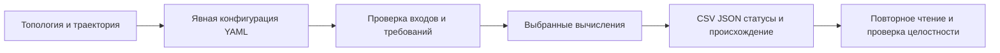

# Руководство пользователя MANIA

MANIA преобразует явно заданный запрос молекулярного анализа в научные CSV/JSON,
статусы методов и сведения о происхождении. Ядро независимо; для чтения координат
нужен дополнительный MD-runtime. Руководство описывает **публичный снимок
исходников**, включая RMSF/SASA: [настройки и применение](configuration.md#rmsf-sasa),
[определения](science.md#rmsf-sasa), [выходы](outputs.md#rmsf-sasa).
Версия в метаданных остаётся **0.2.0**. Обновление ветки исходников не является
новым нумерованным выпуском; сохраняйте публичный Git commit, поскольку одной
версии недостаточно для отличия от первоначального публичного снимка. Техническая
проверка не устанавливает научную пригодность конкретного входа и применения.

Начните с [Быстрого старта](quickstart.md), затем прочитайте [Режимы](modes.md),
[Конфигурацию](configuration.md) и [Результаты](outputs.md). Перед интерпретацией
измерений своей системы обратитесь к [Научному справочнику](science.md).

| Задача | Руководство |
| --- | --- |
| Установить пакет и выполнить синтетический пример вне репозитория | [Быстрый старт](quickstart.md) |
| Просмотреть план, запустить расчёт, понять коды выхода | [Команды](commands.md) |
| Описать входы, выборки, время и научные источники | [Конфигурация](configuration.md) |
| Выбрать Basic, Custom, Full или Exploratory | [Режимы](modes.md) |
| Понять формулы, популяции и ограничения | [Наука](science.md) |
| Найти, прочитать и проверить результаты | [Результаты](outputs.md) |
| Выбрать NaPi2b и понять внешних потребителей | [Расширения](extensions.md) |
| Сохранить воспроизводимый научный результат | [Воспроизводимость](reproducibility.md) |

## Полезные термины

| Термин | Значение в руководстве |
| --- | --- |
| Топология / траектория | Идентичности атомов/остатков и связи / упорядоченные снимки координат |
| RIN | Сеть взаимодействий остатков: остатки — узлы, взаимодействия — рёбра |
| Roster / популяция | Упорядоченный набор идентичностей / точные наблюдения, включённые в расчёт |
| Mapping / reference | Явное соответствие источника эталону / объявленные нумерация и химия остатков |
| Provenance | Записанные происхождение, конфигурация, версии, идентичности и статус результата |
| QC / replay | Проверки качества по переданной политике / восстановление из завершённых сохранённых наблюдений |

> **Научное предупреждение.** Первый исследовательский запуск выполняет реальные
> реализованные методы, но не подтверждает научную пригодность. Каждый запуск
> Exploratory сохраняет `SCIENTIFIC_VALIDATION_NOT_PERFORMED` и
> `authoritative_release_eligible=false`. Basic/Custom/Full сохраняют строгие
> требования к входам; их технический успех также не подтверждает реальную приёмку
> реальных научных входов, правильность биологии или готовность к публикации.

[Выбор языка](../README.md) · [Обзор репозитория](../../README.md)

Этот снимок включает утверждённый [SASA frame_stride](configuration.md#sasa-frame-stride)
и исправление совместимости source paths B-01. Исторические нумерованные артефакты
не меняются; публикация исходников и научная квалификация — отдельные этапы.

---

[Все руководства](README.md) · [English](../eng/README.md)
