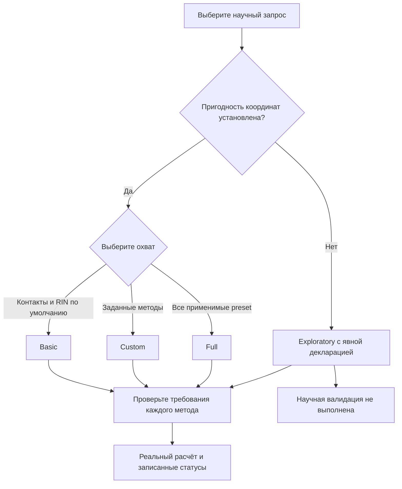

# Выбор режима

Режим выбирает набор запросов, а не уровень научного одобрения. Все режимы
используют одинаковые исходные методы и численные контракты. Для первого запуска
подойдёт [синтетический пример в отдельной папке](quickstart.md#copy); для своей
системы установите [научные предпосылки](science.md).

| Возможность / требование | Basic | Custom | Full | Exploratory |
| --- | --- | --- | --- | --- |
| Белковые тяжёлоатомные контакты + static RIN | По умолчанию, обязательны | Явно или через зависимости | По умолчанию, обязательны | По умолчанию; запрос можно изменить |
| Автоматический белковый Rg после полной проверки | Условно | Нет | Условно | Отключён |
| Явный Rg | Выборка/массы/пригодные координаты | То же | То же | Проверки выборки/масс/входов сохранены; PBC остаётся неквалифицированным |
| RMSD | Явные fit/evaluation/reference | То же | То же | То же; legacy по-прежнему требует подготовленного представления |
| Сообщества / typed outputs / temporal RIN / fingerprints / PCA / clustering | Явно | Явно | Применимые preset | Явно |
| Обогащение областей | Явные annotations/reference/mapping | То же | Кандидат при переданных аннотациях | Явные источники |
| Физические окна / липиды / гликаны | Явные источники времени/варианта/партнёров | То же | При переданных применимых источниках | Явные источники |
| Сравнения / реплики | Явные метод и группы | То же | Рассматриваются переданные совместимые группы | Явные метод и группы |
| QC / replay / профильные выходы | Явный запрос со связанными источниками | То же | Явно | Явно; профильный выход — preview |
| Непериодические / подготовленные координаты | Строго | Строго | Строго | Доступны, квалификация не подтверждается |
| `pbc.mode: unverified` | Отвергается | Отвергается | Отвергается | Требует явной декларации |
| Активация NaPi2b | Явная установка и выбор | То же | То же | То же; официального Dataset-v1 release нет |



<a id="basic"></a>
## Basic: контакты и статическая RIN

Basic выбирает белковые контакты (`heavy`, 4.5 Å, `min_frequency: 0.0`) и
статическую RIN с метриками узлов. Эти два метода нельзя отключить в Basic/Full.
Химия типов, нужная для того же графа, считается внутри и без отдельно
запрошенного typed-экспорта. Полностью развёрнутый эквивалентный Custom должен
сохранять тот же научный граф и метрики.

Автоматический Rg требует однозначной полной группы нужного белка, корректных
масс/входов и установленной пригодности координат. Неустановленная пригодность
даёт объяснённый необязательный статус; доказанная неприменимость отличается от
неизвестности. Ошибочный явный Rg — ошибка. Учебный пример отключает Rg: частичный
искусственный белок не доказывает пригодность. RMSD не включается автоматически.

[Basic YAML](../../examples/basic.yaml) → `results-basic`. В новой скопированной
папке, с установленной командой `mania`:

```sh
mania run --config basic.yaml --dry-run
mania run --config basic.yaml
mania artifacts validate --root results-basic
```

<a id="custom"></a>
## Custom: точный запрос методов

Custom требует хотя бы один явно включённый метод. Зависимости добавляются;
отключение нужной зависимости ошибочно. Глобальные опции переопределяют preset,
затем `systems[].method_overrides` — переданные поля для данного входа.
Автоматического Rg в Custom нет. Каждый включённый RMSD требует `fit_selection`,
`evaluation_selection` и явно выбранного эталона.

[Custom YAML](../../examples/custom.yaml) добавляет fit-атомы `index 0 1 2`,
evaluation-атом `index 3` и `{kind: first_selected}` к contacts/static RIN.
Сохранены принятая искусственная геометрия и точные RMSD-проверки, включая
настоящий численный остаток самосовмещения первого кадра. Это не утверждение
о RMSD реального белка.

```sh
mania run --config custom.yaml --dry-run
mania run --config custom.yaml
mania artifacts validate --root results-custom
```

<a id="full"></a>
## Full: применимые реализованные семейства

Full добавляет сообщества, typed-экспорт, временную RIN по выбранным кадрам,
fingerprints, PCA, кластеризацию и кандидатов физических/партнёрских окон.
Отсутствующие необязательные источники дают `missing_optional_input`; реальные
вырождения сохраняют статус конкретного метода. Явные ошибки нельзя молча
пропускать. Enrichment требует annotations/reference/mapping; физические окна —
явного физического времени и `variant_id`, а партнёрские методы дополнительно
`partners_path`. Переданные группы сравнения/реплик рассматриваются со своими
источниками соответствий и доступности.

Full не выдумывает эталон RMSD, не активирует NaPi2b, не выбирает научную QC-политику,
не включает replay/профильные выходы и не реализует RMSF/SASA/вторичную структуру.
Большее число preset-методов не подтверждает более высокую научную квалификацию.

[Full YAML](../../examples/full.yaml) → `results-full`. В малом сохранённом наборе
контактных наблюдений недостаточно данных для PCA/кластеризации; неприменимость
честно сообщается вместо выдуманных проекций или меток.

```sh
mania run --config full.yaml --dry-run
mania run --config full.yaml
mania artifacts validate --root results-full
```

<a id="exploratory"></a>
## Exploratory: настоящий расчёт без подтверждённой квалификации

Белковые контакты и статическая RIN по умолчанию используют те же 4.5 Å/heavy/0.0.
Другие поддерживаемые методы требуют явного запроса и своих научных источников.
Автоматический Rg отключён. Явный Rg сохраняет проверки выборки/масс/входов;
непроверенный PBC остаётся научно неподтверждённым. Generic RMSD по-прежнему требует
эталона и соответствия; legacy mapped-Cα сохраняет правила подготовленного входа.
Сравнения, реплики, replay, QC и явно выбранный NaPi2b доступны при полных
совместимых источниках. Внутренних MIC, wrap, unwrap и центрирования нет.
Неизменённые декартовы расстояния могут быть физически непригодными.

Только Exploratory принимает `pbc.mode: unverified` с содержательной `declaration`;
к этому режиму нельзя приложить preparation evidence. Проверенные nonperiodic/
prepared-входы внутри Exploratory не повышают научную квалификацию запуска.
Пустой эффективный запрос или отключённая обязательная зависимость отвергаются.

[Exploratory YAML](../../examples/exploratory.yaml) → `results-exploratory`.
Намеренно непроверенная декларация демонстрирует оба кода предупреждений:

```sh
mania run --config exploratory.yaml --dry-run
mania run --config exploratory.yaml
mania artifacts validate --root results-exploratory
```

Любой исход сохраняет `SCIENTIFIC_VALIDATION_NOT_PERFORMED`,
`authoritative_release_eligible=false` и при необходимости `PBC_UNVERIFIED`.
Эти записи переживают технический успех, QC PASS, ошибку, отмену и повторное
чтение. Exploratory не предоставляет научно квалифицированные авторитетные входы
для выпуска FAIR. Выбранный NaPi2b создаёт лишь предварительный
[preview](extensions.md#preview), без официальной печати Dataset-v1 release.
Basic/Custom/Full остаются строгими; Exploratory не сокращает путь к одобрению.

---

[Все руководства](README.md) · [English](../eng/modes.md)
