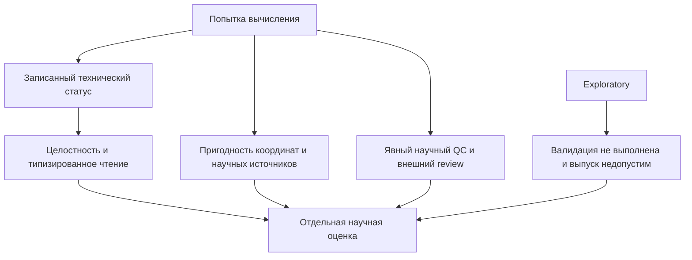

# Практическая воспроизводимость

## Сохраните научный запрос и его источники

Для воспроизводимости одной команды недостаточно. Сохраняйте оригинальные
входы только для чтения и точный YAML, input identities, topology/atom order,
порядок траекторий, выбранные исходные кадры, реальные времена, PBC-декларацию
и внешние preparation evidence. Сохраняйте явные reference/mapping/annotation,
partner, matching, replica и QC/review источники с происхождением и правами.
Не восстанавливайте эти факты из имени папки результата.

| Запись | Что устанавливает / чего не устанавливает |
| --- | --- |
| Размер входа/источника и SHA256 | Точные связанные байты, не физическую правильность |
| Эффективная конфигурация и параметры методов | Что запрошено и фактически разрешено |
| Frame/time/atom/reference rosters и digests | Точную измеренную популяцию и научное соответствие |
| Runtime/software/dependency identity | Использованное окружение, не универсальное межверсионное равенство |
| Завершённые observations и статусы | Реальные computed, missing, failed, pending исходы |
| Переданные policy/reviewer evidence | Реальные полномочия и решения, не выдуманное одобрение |

Выходные provenance/inventory записывают роли без перезаписи оригиналов.
`checksum_mode: sha256` запрашивает полное хеширование настроенных входов;
учитывайте I/O больших файлов. `none` не снимает обязательных хешей reference/
authority. Dry-run не хеширует огромную траекторию и не устанавливает полную
совместимость кадров.

## Сохраните установленное численное окружение

Обычная установка pip из [Быстрого старта](quickstart.md#install) предназначена
для знакомства. Строгое численное воспроизведение требует записанного
и контролируемого окружения. Запишите версию/сборку Python, `mania-wania`,
версии выбранных расширений, NumPy, SciPy, MDAnalysis, BLAS и точные
артефакты/версии/хеши остальных зависимостей. Для точных сравнений нужны
те же входы, опции, порядок, source decisions, BLAS и thread settings. Побайтовое
равенство SVD/float между разными Python, BLAS, платформами или зависимостями
не обещается. Не добавляйте допуски и не меняйте округление ради сокрытия разности.

Метаданные Python >=3.11 не доказывают квалификацию окружения. Когда нужна
строгая воспроизводимость, сохраняйте полный lock зависимостей для выбранного
runtime и wheelhouse оригинальных артефактов с проверенными хешами. Это
необязательные меры для такого workflow, а не поставляемые требования к новичку.
Записывайте способ разрешения зависимостей и установки; краткий список версий
не заменяет полный lock. Base работает без MDAnalysis. Установка неактивного
NaPi2b не должна менять научные выходы Core или зависимости. Выбранные
профильные проекции записываются отдельно.

Пакетное поведение проверяют обычным установленным колесом, из постороннего cwd
с изолированным Python. `python -I -B -m mania` исключает обычный source/PYTHONPATH
fallback и запись bytecode. Editable-импорт или успешная syntax check не доказывает
обычное установленное выполнение. Source sdist включает пользовательские docs/
examples; wheels предоставляют API пакета, не API учебных ресурсов. Тесты
и внутренние рабочие материалы не входят в обычный пакетный контракт.

## Прочитайте и сохраните настоящие исходы

1. Изучите `summary.json` и status/reason каждого запрошенного метода.
2. Проверьте явный root: `mania artifacts validate --root /path/to/result`.
3. Сохраните вместе effective config, plan, runtime, provenance, inventory и всю науку.
4. Сохраняйте observation/completion/plan для replay и downstream aggregation.
5. До объединения реплик/условий проверьте reference/window/partner/availability authority.

Typed read-back проверяет identities, схемы, научные структуры и применимые хеши.
Он может установить целостность честно ошибочного запуска, но не повысить статус.
Missing остаётся missing; null-статистика не равна нулю; unavailable-реплики
не становятся доступными negatives. Отделённый CSV не устанавливает полноту
или научную квалификацию источника. Автоматических resume/overwrite нет.
Для воспроизведения учебного примера создавайте новую независимую папку.

## Технический успех и научная квалификация

**Целостность**, **QC** и **научное одобрение** различаются. Правильные checksum
не доказывают пригодность PBC. QC PASS не одобряет биологию или публикацию.
Exploratory сохраняет `SCIENTIFIC_VALIDATION_NOT_PERFORMED`,
`authoritative_release_eligible=false`, применимый `PBC_UNVERIFIED` и при
техническом успехе, подготовленных прямых входах или успешной выбранной политике.
Строгие потребители отвергают такие upstream как авторитетные доказательства;
Exploratory-потребители сохраняют унаследованную квалификацию. NaPi2b preview
не одобряет Dataset-v1 release.

## Границы имеющихся доказательств

Поставляемый PDB с двумя моделями/четырьмя атомами и искусственные source-chain
тесты проверяют реализованные формулы, точное равенство исходному API, валидацию,
negative-поведение и малые установленные workflow. Они не устанавливают научную
пригодность реальных TPR/XTC или PSF/DCD, скорость больших систем, биологическую
интерпретацию, принятую PBC-подготовку или готовность публикации. Процент в терминале
и успешный технический код имеют те же ограничения.

Обычные технические проверки используют малые/искусственные входы или fake-runtime.
Тяжёлая локальная MD остаётся local-only, не требуется default CI и нуждается
в отдельно разрешённых входах и научной приёмке. Конфигурация удалённого CI
не является его реальным запуском.

**Научная квалификация реальных входов не завершена.** Нужны отдельно разрешённые
настоящие входы, coordinate/time/selection/source authority, совместимый runtime
и научные сравнения/решения экспертов. Учебный пример, конфигурация удалённого CI
или историческая квитанция не заменяют проверок. Записывайте настоящие ошибки;
недоступные проверки — NOT RUN/BLOCKED, никогда PASS. Будущие RMSF/SASA/вторичная
структура, внутренняя PBC-подготовка, файлы научных констант и автоматический
анализ чувствительности не являются реализованными возможностями.

[Научные определения](science.md) · [Интерпретация результатов](outputs.md)

---

[Все руководства](README.md) · [English](../eng/reproducibility.md)
