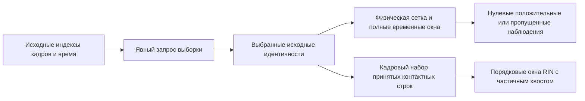

# Научный справочник

Определения ниже описывают реализованное поведение, а не научное одобрение конкретной траектории. Единицы, популяции и правила пропусков входят в метод. [Конфигурация](configuration.md) перечисляет доступные параметры; [Результаты](outputs.md) объясняют сериализацию и повторное чтение.

**Навигация:** [Чтение траекторий и идентичность источника](#readers) · [Исходные кадры и наблюдённое время](#frames) · [Физическая выборка и два механизма окон](#time-windows) · [Пригодность координат и PBC](#pbc) · [Белковые контакты и backbone](#contacts) · [Химия типизированных взаимодействий](#chemistry) · [Контакты белок–липиды и белок–гликаны](#partners) · [Частота, occupancy и популяции расстояний](#frequencies) · [Эпизоды и времена жизни](#episodes) · [Покадровые наблюдения и replay](#replay) · [Радиус инерции Rg](#rg) · [RMSD: раздельные fit и evaluation](#rmsd) · [Статическая RIN и смысл графа](#static-rin) · [Центральности и сетевые метрики](#centralities) · [Сообщества и обогащение переданных областей](#communities) · [Временная RIN и оконные метрики](#temporal-rin) · [Отпечатки контактов](#fingerprints) · [PCA отпечатков взаимодействий](#pca) · [Детерминированная кластеризация](#clustering) · [Сопоставленные сравнения и парная статистика](#comparisons) · [Эталон, mapping и аннотации](#reference) · [Проекция научных оконных таблиц](#projection) · [Агрегация реплик](#replicas) · [QC, raw MAD и научные политики](#qc) · [Передача результатов, происхождение и ограничения](#handoff)

<a id="readers"></a>
## Чтение траекторий и идентичность источника

Совместимая топология и упорядоченные координатные файлы устанавливают идентичность
атомов/остатков и исходную ось кадров. Исходные поддерживаемые реальные семейства —
GROMACS TPR/XTC и NAMD PSF/DCD через необязательный MDAnalysis==2.10.0. Поставляемый
PDB — искусственный пример общего loader, а не квалификация дополнительного
реального workflow. Порядок сохраняется, readers закрываются при ошибках.
Загрузка не выводит биологический mapping, подготовку или физическую пригодность.

NAMD требует один связанный DCD и явные источники элементов/времени. Ключи типов
PSF должны соответствовать принятым CHARMM-элементам или переданным проверенным
назначениям; элементы не выводятся из масс и имён атомов. Время связывает буквальные
параметры config/log с DCD header/count/source. Отсутствующие или противоречивые
controls блокируют координатный метод. Время не выводится из имён папок.

Шаги записи NAMD: `range(firsttimestep + dcdfreq, numsteps + 1, dcdfreq)`;
`time_ps(step) = Decimal(step)*Decimal(timestep_fs)/1000`. Это назначение исходного
времени, не координат. Расстояния измеряются в Å, сохранённое время — в пс.
Научная идентичность — явный составной ключ, не путь или метка condition.
Неверные/нечитаемые входы дают сведения об ошибке, не нулевые измерения.

Реализация: [trajectory loader](../../src/mania/preprocessing/trajectory_loader.py),
[NAMD authority](../../src/mania/preprocessing/namd_authority.py).

<a id="frames"></a>
## Исходные кадры и наблюдённое время

Выборка сохраняет **исходные** индексы с нуля. Defaults: start 0, stride 1,
без stop и максимума. `start` включён, `stop` исключён, шаг отсчитывается от start,
явный `max_frames` ограничивает выбранное число. Точные indexes возрастают
и уникальны; конкурирующие selectors отвергаются. Номер строки результата
не заменяет исходный индекс; отсутствующие запрошенные кадры не выдумываются.

Legacy-время контактов предпочитает пригодное `timestep.time`; явное
`source_index*frame_time_ps` используется лишь как fallback. Legacy Rg всей группы,
напротив, позволяет явному `frame_time_ps` переопределить timestep time. Новые
physical/NAMD-пути сохраняют собственное авторитетное назначение времени. Эти
контракты Python/API нельзя заменять якобы универсальным приоритетом времени.

Наборы наблюдённых кадров contacts/Rg должны согласовываться. Совместимые известные
времена используют симметричное `min(contact_time, rg_time)` с существующим
`isclose(rel_tol=1e-9, abs_tol=1e-9 ps)`; единственное известное время сохраняется.
Равномерность требует >=2 известных моментов и положительных согласованных
разностей; шаг — `fsum(differences)/Ndiff`. При пропусках/малой выборке шаг
недоступен; известная неравномерность даёт `non_uniform`, без интерполяции.

Реализация: [выборка кадров](../../src/mania/preprocessing/trajectory_frame_sampling.py),
[происхождение](../../src/mania/run_provenance.py).

<a id="time-windows"></a>
## Физическая выборка и два механизма окон

Физическая выборка строит замкнутую сетку из строковых Decimal-значений:
`t_k = 1000*production_start_ns + k*frame_stride_ps`, пока
`t_k <= 1000*production_end_ns`. Цель требует единственного исходного совпадения
по существующему `isclose(rel_tol=1e-9, abs_tol=1e-6 ps)`. Snapping, clamping,
выбор ближайшего и повторное использование исходного кадра не устраняют
неоднозначность. Пропуски остаются записями; покрытие — resolved/requested.
Эффективный шаг доступен лишь для полной последовательной разрешённой сетки
с >=2 samples. Физический запрос не обязан содержать окна.

| Механизм | Принадлежность, знаменатель и границы |
| --- | --- |
| Физические окна | Decimal-начала `start_j=start+j*step`, `end_j=start_j+length <= production_end`; только полные окна; принадлежность по **запрошенному** времени, метрики по фактически разрешённым наблюдениям |
| `mania.window_boundaries.legacy.v1` | `[start,end)`, кроме окна, точно заканчивающегося на production end: конец включён |
| `mania.window_boundaries.inclusive.v1` | У каждого окна обе границы включены |
| Временная RIN по выбранным кадрам | Срезы отсортированных уникальных индексов принятых контактных строк по порядковым позициям; defaults 10 кадров / шаг 10 / частота 0.25; последнее достигнутое непустое частичное окно допускается |

Для физических окон `0 < step <= length`; перекрытие `100*(1-step/length)` в
[0,100) проверяется существующим правилом relative 1e-9 / absolute 1e-6 процентных
пункта. Перекрывающиеся окна намеренно используют samples повторно между окнами.
Отсутствие полного окна или разрешённых наблюдений — не полный нулевой результат.



Legacy CSV только с заголовком не даёт sampled roster и не доказывает полностью
нулевую траекторию. Physical coverage sidecars и completion observations имеют
более богатый контракт zero/missing. Эти механизмы нельзя подменять друг другом.

Реализация: [физическая выборка](../../src/mania/preprocessing/physical_time_sampling.py),
[физические окна](../../src/mania/preprocessing/physical_time_windows.py),
[временные окна RIN](../../src/mania/analysis/temporal_rin_windows.py).

<a id="pbc"></a>
## Пригодность координат и PBC

Строгие Basic/Custom/Full используют объявленные непериодические либо внешне
подготовленные координаты с относящимися к источнику доказательствами. Prepared
не означает научный вердикт: нужна подходящая неразорванная репрезентация полного
нужного белка именно для данной операции. Ненулевая ячейка противоречит
nonperiodic-декларации; одна ячейка не устанавливает пригодность.

Внутренних MIC, wrap, unwrap, центрирования и изменения координат нет. Поэтому
декартовы расстояния через периодическую границу могут быть физически неверны.
Exploratory позволяет явно объявить unverified PBC, сохраняя остальные требования
методов и неподтверждённую квалификацию результата. Автоматический Rg там отключён;
явный Rg возможен с независимо пригодными selection/массами/входами, но PBC остаётся
неподтверждённым. Legacy mapped-Cα требует своей принятой подготовленной
репрезентации. Существующие допуски наблюдений описывают наблюдения, а не новый
порог научной пригодности.

См. [настройку PBC](configuration.md#pbc) и
[квалификацию](reproducibility.md#qualification).

<a id="contacts"></a>
## Белковые контакты и backbone

Цель — найти пары остатков, сближающихся в выбранных координатах. Run-preset
выбирает тяжёлые атомы белка; явная `selection: all` задаёт другую популяцию.
`residue_index` локален топологии; `resid`, resname и сегмент сохраняются отдельно.
Самопары и повторные неупорядоченные пары исключаются.

Для различных A и B `d_min(A,B)=min ||r_a-r_b||` по выбранным парам атомов;
`residue_contact` есть при `d_min <= cutoff_distance`, default **4.5 Å**.
Сохранённый общий heavy-filter исключает element H или свой legacy H-name fallback;
типизированная химия и строгая heavy-authority партнёров имеют отдельные правила.
Пропущенные координаты/пустая атомная группа — проблемы, не нулевые расстояния.

Backbone отделён: topology indexes `j=i+1` при protein-selection, одинаковый
`segid`, доступные CA и `d(CA_i,CA_j) <= 4.5 Å`. Соседство числовых номеров
остатков не является правилом. Представительные CA сохраняют исходный кадр
наблюдения; это не усреднённая по времени структура.

Вычислительные пределы Python по умолчанию None (без лимита), а не скрытый предел
кадров/пар. Явные ограничения пар/вычислений расстояний отвергают строго превышенный
кадр до химии; равенство допустимо. Популяция не обрезается. Отвергнутый пустой
кадр — неуспешное наблюдение, не измеренное отсутствие контактов.

Реализация: [контакты](../../src/mania/preprocessing/trajectory_contacts.py),
[химия](../../src/mania/preprocessing/trajectory_contact_chemistry.py).

<a id="chemistry"></a>
## Химия типизированных взаимодействий

| Тип | Реализованная геометрия (Å, если не указано иное) |
| --- | --- |
| `hbond` | D–A <= 3.5; переданная связь donor–H; D–H–A >= 120°; именное правило N/O donor/acceptor |
| `disulfide` | CYS SG–SG <= 2.2 |
| `salt_bridge` | LYS NZ / ARG NH1,NH2 против ASP OD1,OD2 / GLU OE1,OE2; минимум <= 4.0 |
| `ionic` | Те же отрицательные атомы; положительные LYS/ARG и HIS/HID/HIE/HIP ND1,NE2; минимум <= 6.0 |
| `hydrophobic` | CB–CB <= 5.0 для ALA,VAL,ILE,LEU,MET,PHE,TRP,PRO,TYR; без CA fallback |
| `vdw` | 3.0 <= минимум тяжёлоатомное расстояние <= 4.5 |
| `aromatic_pi` | Полные именные кольца; расстояние центров <= 7.0; угол нормалей < 30° либо 60°–120° включительно |
| `cation_pi` | LYS NZ либо ARG CZ до центра кольца **строго < 6.0** |

Эти геометрические метки описывают реализованные именные правила, а не выведенное
состояние протонирования или экспериментальное доказательство химической связи.
Типы могут сосуществовать. H-bond требует явного связанного с топологией H;
восстановления H нет. Из подходящих наблюдений сохраняется минимальное D–A.
Вырожденные угловые векторы (длина <=1e-12) не дают угла/контакта; геометрия
не угадывается.

Наборы колец: PHE/TYR `CG CD1 CD2 CE1 CE2 CZ`; TRP
`CG CD1 CD2 NE1 CE2 CE3 CZ2 CZ3 CH2`; HIS/HID/HIE/HIP
`CG ND1 CD2 CE1 NE2`. Центр — арифметическое среднее; нормаль — вектор наименьшего
собственного значения матрицы рассеяния координат по сохранённому 3×3 Jacobi
(32 итерации, геометрический допуск 1e-12). Отсутствующее, неполное или коллинеарное
кольцо не даёт пригодной нормали. Угол использует `abs(dot(n1,n2))`, поэтому острый
(<=90°); указанная ветвь 60°–120° фактически достигает 90°. Ровно 30° не считается
параллельностью, ровно 6 Å не считается cation–π. Замена библиотеки или новый
настраиваемый набор химических порогов не подразумевается.

Реализация: [таблицы атомов](../../src/mania/preprocessing/trajectory_contact_chemistry.py),
[геометрия](../../src/mania/preprocessing/trajectory_interaction_geometry.py).

<a id="partners"></a>
## Контакты белок–липиды и белок–гликаны

Цель — измерить близость остатка белка к полному объявленному молекулярному
партнёру. Идентичность/тип компонентов, атомный состав, connectivity и связь
гликана с carrier задаются метаданными/топологией; универсального реестра имён
липидов/гликанов нет. Локальные ID не задают эквивалентность между репликами.

Минимальное декартово тяжёлоатомное расстояние до **целого партнёра** определяет
контакт: липид **<=6.0 Å**, гликан **<=4.5 Å**. Тяжёлые атомы задаются явными
подтверждёнными элементами или atomic numbers (1..118, взаимно согласованные);
угаданные метаданные отбрасываются. Неверная heavy-репрезентация ошибочна даже без
липидов. Bounding-box rejection ускоряет ту же точную геометрию и не должен
отбрасывать реально близкие пары.

Положительное наблюдение проверенной carrier/first-sugar связи остаётся в raw
с `standard_summary_excluded=True` и причиной ковалентного исключения. Оно
исключается из обычных occupancy, episodes и distances, не превращается в negative
и не убирает несвязанные контакты carrier. Отсутствующая/противоречивая связь
ошибочна. Нет партнёров — пустой результат применимой области; неизвестные
партнёры не доказанно отсутствуют. Покадровые и оконные identities согласованы.

Реализация: [липиды](../../src/mania/preprocessing/protein_lipid_contacts.py),
[гликаны](../../src/mania/preprocessing/protein_glycan_contacts.py).

<a id="frequencies"></a>
## Частота, occupancy и популяции расстояний

Цель — описать устойчивость и близость контактов, не смешивая разные популяции
наблюдений. Частоты/occupancy безразмерны [0,1]; расстояния и их SD измеряются в Å.

| Семейство результата | Числитель / знаменатель и популяция расстояний |
| --- | --- |
| InteractionAccumulator / белковые typed aggregates | Уникальные положительные кадры / переданное число выбранных кадров; среднее и population SD расстояния считают каждое сохранённое add-наблюдение |
| Legacy `contact_edges.csv` | Один минимум pair/type/included frame; положительные кадры / включённые кадры; default исключает ошибочные |
| Graph export | Всегда исключает ошибочные кадры; упрощение по primary type с его статистикой |
| Occupancy физического окна | Положительные кадры / все **разрешённые** кадры окна с завершёнными вычислениями, включая доказанные negatives; пропуски запроса исключены |
| Партнёрские оконные расстояния | Среднее/минимум покадровых минимумов только обычных положительных контактов; raw covalent-excluded гликаны отдельно |

Формулы accumulator: `f=|unique positive frames|/Nsampled`,
`mean_d=sum(d)/Noccurrence`, `SD_d=sqrt(sum((d-mean_d)^2)/Noccurrence)`.
Одно расстояние имеет population SD 0. Фильтр accumulator `min_frequency`
сохраняет равенство (`f >= threshold`, default 0.0); legacy CSV/graph — отдельный
механизм без этого фильтра. Явный CSV `include_failed_frames=True` меняет включённый
знаменатель и сохраняет предоставленные контакты/issues, но не доказывает научный
успех этих кадров.

Физические sparse-строки существуют для положительных pair/type/window.
Знаменатель occupancy — разрешённые кадры; `coverage_fraction=resolved/requested`
отдельно описывает покрытие. Полное доступное окно без ребра может обосновать
частный ноль в агрегации; одно отсутствие sparse-строки ничего не доказывает.
Неуспешные планы или неполное вычисление разрешённых кадров запрещают точную
агрегацию. При нулевом знаменателе частота не выдумывается.

Реализация: [accumulator](../../src/mania/preprocessing/trajectory_contact_accumulator.py),
[физические белковые окна](../../src/mania/preprocessing/protein_edge_windows.py).

<a id="episodes"></a>
## Эпизоды и времена жизни

Цель — различить устойчивый контакт и прерывистые положительные наблюдения.
Эпизод — максимальная последовательность положительных **позиций запрошенной
выборки**. Разрешённый negative или пропущенная позиция запроса разрывает её.
Числовые разрывы source indexes не разрывают последовательность соседних
запрошенных позиций. Окна и реплики независимы, включая перекрывающиеся окна.

`length_ns=(last_actual_time_ps-first_actual_time_ps)/1000`; один кадр — **0 ns**.
Среднее/максимум считаются по этим длинам; дополнительный шаг не прибавляется.
Допустимый разрыв — ровно **0 кадров**. Без positives число эпизодов 0,
средняя/максимальная длина null. Непрерывность запроса не разрешает интерполяцию.
Legacy placeholders lifetime/window-CV не являются этими вычисленными физическими
оконными метриками и не заполняются предположениями.

Реализация: [эпизоды](../../src/mania/preprocessing/contact_episodes.py).

<a id="replay"></a>
## Покадровые наблюдения и replay

Цель — восстановить принятые оконные сводки без открытия координат.
Физические observation-артефакты хранят исходные/запрошенные identities кадров,
реальное время, positives, завершённые zeros, missing/failed и completion.
Replay сначала проверяет точный roster, identities, completion и SHA256,
затем вызывает те же правила агрегации без повторного сопоставления времени.
Пустой CSV без completion не является измеренной нулевой траекторией. Устаревшие,
неполные или изменённые доказательства блокируют точное восстановление.

Запрос `replay` задаёт `completion_path` и `execution_plan_path`. Сохранённые
контактные CSV/fingerprint используют отдельную популяцию принятых строк и
не подменяют более полные физические completion evidence. Метки технического
подмножества не устанавливают полноту научной передачи результатов.

Реализация: [наблюдения](../../src/mania/preprocessing/perframe_observations.py),
[replay](../../src/mania/preprocessing/window_replay.py).

<a id="rg"></a>
## Радиус инерции Rg

Цель — оценить пространственный разброс явно установленной атомной группы
вокруг центра масс. Реализация вызывает существующий MDAnalysis
`AtomGroup.radius_of_gyration()` выбранной группы без аргументов преобразования.
Единица — **Å**; разные атомные популяции означают разные измерения.

`M=sum(m_i)`, `r_COM=sum(m_i*r_i)/M`,
`Rg=sqrt(sum(m_i*||r_i-r_COM||^2)/M)`.

Автоматический белковый Rg Basic/Full требует трёх условий: однозначной полной
группы/цепей нужного белка, корректных масс/конечных данных и доказанной пригодности
координат. Непустой `protein` недостаточно. FASTA/mapping необязательны, когда
топология уже устанавливает группу. Неизвестная пригодность даёт объяснённое
необязательное невыполнение; неверный явный запрос ошибочен. После установления
пригодности ошибка расчёта остаётся failed. `include_failed_frames: true`
сохраняет диагностические строки, не успешные измерения.

Legacy Rg всей загруженной системы остаётся отдельным Python API и не становится
неявно protein/heavy Rg. Пропущенные/нефинитные/отрицательные результаты остаются
failed/null. Exploratory не включает автоматический Rg; явный результат с
unverified PBC остаётся неквалифицированным и при пригодных остальных входах.

Нынешний generic run controller устанавливает автоматическую protein identity по явному молекулярному roster и проверяет неугаданные положительные массы. Его наблюдение PBC для Rg устанавливает объявленный nonperiodic-случай с отсутствующей/нулевой ячейкой; пригодность prepared-координат для Rg в этом контроллере остаётся unestablished. Поэтому одной prepared-декларации/пути evidence недостаточно для строгого Rg: автоматический запрос может быть пропущен, явный — завершиться ошибкой. Этот консервативный допуск не подготавливает и не одобряет координаты.

Реализация: [Rg](../../src/mania/preprocessing/trajectory_rg.py),
[выполнение выбранной группы](../../src/mania/preprocessing/run_execution.py).

<a id="rmsd"></a>
## RMSD: раздельные fit и evaluation

Цель — измерить смещение evaluation-атомов после жёсткого правильного совмещения,
построенного только по fit-атомам. Координаты/операции равновесовые float64;
единица результата **Å**. Формулы для векторов-строк:

```text
muX = mean(Xfit); muY = mean(Yfit)
U, S, Vt = svd((Xfit-muX).T @ (Yfit-muY))
D = diag(1, 1, +1 if det(U @ Vt) >= 0 else -1)
R = U @ D @ Vt
Ealigned = (Xevaluation-muX) @ R + muY
RMSD = sqrt(sum(||Ealigned_i-Yevaluation_i||^2) / Nevaluation)
```

Отражения и независимого повторного совмещения/центрирования evaluation нет.
Fit требует >=3 конечных правильно соответствующих неколлинеарных атомов
(NumPy matrix rank >=2); evaluation — >=1 конечного атома без отдельного rank.
Пустые, неоднозначные, переставленные или несовместимые соответствия ошибочны.
Эталон явно задаётся как `first_selected` либо внешние координаты со строгим
atom mapping. Первый кадр может сохранить малый настоящий численный остаток
самосовмещения; округление до предполагаемого нуля или новый допуск не обоснованы.
Сериализация RMSD использует `.17g`.

Legacy выбранного NaPi2b mapped-Cα RMSD имеет отдельный same-set API: один CA
с element C на явно mapped-остаток, canonical-порядок, фиксированный reference/
roster, prepared-происхождение и первый разрешённый production sample как эталон.
Пропущенные samples сохраняют null; callback не переопределяет эталон.
Ни один путь RMSD не выдумывает порог дрейфа или биологическую интерпретацию.

Реализация: [RMSD](../../src/mania/preprocessing/trajectory_rmsd.py),
[чтение внешних эталонов](../../src/mania/result_readers.py).

<a id="static-rin"></a>
## Статическая RIN и смысл графа

Цель — описать топологию взаимодействий остатков. Статическая RIN — неориентированный
простой граф: узлы — остатки, рёбра — нормализованные пары. Изолированные узлы roster
могут сохраняться. Несколько типов пары сохраняются, primary — тип с наименьшим
рангом приоритета. Сохранённая константа — `EDGE_TYPE_PRIORITY`. Порядок:

`backbone → hbond → disulfide → salt_bridge → ionic → cation_pi → aromatic_pi → hydrophobic → vdw → residue_contact`

Вес/частота берётся именно у **primary**, а не как сумма, максимум или объединение
частот сосуществующих типов. `all_edge_types` и `n_edge_types` сохраняют другие
типы. Отсутствующий вес остаётся null. Петли, повторы и несовместимая исходная
идентичность отвергаются при проверке.

Legacy `ContractGraph` — отдельный API: число строк рёбер, типизированные повторы,
обратные строки и петли сохраняют собственный смысл adjacency/strength. Строгий
topology parser отвергает неверные веса; отдельный legacy-анализ записывает 0.0
fallback для отсутствующего/нечислового веса. Это не превращает отсутствующее
научное наблюдение в измеренный ноль. Семейства графов нельзя сравнивать как
имеющие одинаковые популяции узлов/рёбер и defaults.

Реализация: [static RIN](../../src/mania/analysis/static_rin_graph.py),
[legacy graph](../../src/mania/analysis/contract_graph.py).

<a id="centralities"></a>
## Центральности и сетевые метрики

| Метрика | Реализация static RIN / интерпретация |
| --- | --- |
| Degree | `degree_i = number of neighbors`; топологическая связность |
| Strength | `fsum(non-null incident weights)`; изолят 0, все веса инцидентных рёбер отсутствуют → null |
| Betweenness | Невзвешенные зависимости Brandes по упорядоченным источникам; деление на `(n-1)*(n-2)` при n>2; участие в кратчайших путях |
| Closeness | `(reachable/sum_distances)*(reachable/(n-1))`, иначе 0; штраф за недостижимые узлы |
| Eigenvector | Итерация `x = (I+A)x / norm((I+A)x)`; влияние невзвешенных соседей |
| PageRank | `(1-d)/n + d*dangling_mass/n + d*sum(x_j/degree_j)`; d=0.85 |
| K-core | Удаление минимальной остаточной степени с детерминированными равенствами; current core = max(previous core, removed degree) |

Кроме strength центральности **невзвешенные**; частота контакта не является
длиной пути. Обход/порядок и `fsum` сохраняют реализацию. Eigenvector: максимум
5000 итераций, допуск 1e-12; PageRank: максимум 1000, 1e-12. Оба останавливаются
при строгом L1-изменении `< n*tolerance`, начиная с 1/n. Итерационная арифметическая
ошибка/несходимость даёт null всем затронутым узлам, не выдуманные нули.
Малые, пустые по рёбрам и несвязные графы сохраняют исходные определения.

Legacy `graph_metrics` имеет другие defaults: eigenvector 5000/1e-6, PageRank
100/1e-6 и собственную обработку/порядок рёбер. Это не взаимозаменяемые настройки
точности. Единицы — счётчики/безразмерные, не Å или энергия. Topology QC
(компоненты, изоляты, петли, повторы) описывает граф, не физическое качество MD.
Consistency сравнивает exported degree/strength по сохранённому диагностическому
absolute 1e-6; это не научное одобрение.

Реализация: [static metrics](../../src/mania/analysis/static_rin_metrics.py),
[legacy metrics](../../src/mania/analysis/graph_metrics.py),
[consistency](../../src/mania/analysis/graph_consistency.py).

<a id="communities"></a>
## Сообщества и обогащение переданных областей

Цель — найти топологические модули и проверить состав переданных меток областей.
Сообщества определяет детерминированная **жадная оптимизация модулярности**, не
Louvain. Начиная с singleton, алгоритм объединяет связанные пары сообществ
с положительным gain >1e-12 и детерминированным разрешением равенств по составу.
Невзвешенная модулярность `Q=sum_c[L_c/m-(K_c/(2*m))^2]`,
`deltaQ=e_ab/m-K_a*K_b/(2*m^2)`. Здесь m — число рёбер, L — внутренних рёбер,
K — сумма степеней, e_ab — рёбра между сообществами. Граф без рёбер даёт singleton
и Q=0. ID начинаются с 1 и локальны condition, не задают межсистемное биологическое
соответствие. Записанный legacy seed не делает фактический алгоритм случайным.

Enrichment использует **только размеченные узлы**. Для community/region:
a=region внутри, b=другие размеченные внутри, c=region снаружи, d=другие снаружи.
`P(x)=comb(a+c,x)*comb(b+d,a+b-x)/comb(a+b+c+d,a+b)`;
двусторонний Fisher суммирует вероятности с точным целым числителем <= наблюдённого,
с ограничением 1. Это не приближение удвоенным хвостом. Odds ratio `a*d/(b*c)`
при `b*c=0` равен null, не бесконечности.

Нужны хотя бы два сообщества, две области и непустые обязательные margins.
Отсутствие меток/групп даёт явные skipped-строки. Неразмеченные узлы исключаются;
области не выводятся автоматически. Реализованный точный Fisher p-value не имеет
добавленных multiple-testing correction или доверительного интервала и не даёт
недоступные p-values отдельного метода сравнения.

Реализация: [сообщества](../../src/mania/analysis/static_rin_communities.py),
[обогащение](../../src/mania/analysis/static_rin_region_enrichment.py).

<a id="temporal-rin"></a>
## Временная RIN и оконные метрики

Цель — проследить принятую топологию взаимодействий по окнам выбранных кадров.
Для отсортированных уникальных принятых исходных индексов F окно k:
`F[k*step_size : k*step_size+window_size]`. Поля frame start/end — первый/последний
исходные индексы, обе описательные границы включены. Defaults: 10/10 кадров,
`min_frequency: 0.25`; последнее непустое частичное окно допускается.
Частота типа — уникальные положительные кадры / число выбранных кадров окна
(`sampled_frame_count`);
`window_contact_freq >= min_frequency` сохраняет равенство. Primary выбирается
по static-приоритету. Среднее,
population SD/min/max расстояний используют доступные typed distances (`fmean`/`pstdev`).

Отдельная операция метрик использует **активные узлы инцидентных прошедшим рёбрам**,
а не всю топологию. `density=2*m/(n*(n-1))`, `mean_degree=fsum(degrees)/n`;
средняя strength требует известных strength всех узлов. Среднее/максимум
betweenness, среднее closeness, modularity и число сообществ вызывают те же
невзвешенные static-методы. Empty/no-passing/no-node/no-edge сохраняют счётчики,
но summary metrics равны null, не выдуманным нулевой density или сообществам.
`active_frame_count` описывает кадры с принятыми строками до частотной фильтрации.

Builder, metrics API и writer — отдельные операции. Кадры вне accepted-row CSV
не восстанавливаются по числовому диапазону. Поэтому две модели Full-примера
могут дать только одно fingerprint-наблюдение.

Реализация: [окна](../../src/mania/analysis/temporal_rin_windows.py),
[метрики](../../src/mania/analysis/temporal_rin_metrics.py).

<a id="fingerprints"></a>
## Отпечатки контактов

Цель — представить различия взаимодействий двоичной матрицей. Строки — явно
принятый sampled frame roster; признаки — объединение наблюдений нормализованной
пары остатков + edge type. `X[t,f]=1` при наблюдении, иначе 0 внутри проверенной
матрицы. Порядок следует исходным концам и приоритету взаимодействий; признаки
не являются атомными парами или непрерывными расстояниями. Значения безразмерные
0/1 без масштабирования/нормировки.

Реально отсутствующее физическое наблюдение нельзя вменить нулевой строкой.
Повтор frame/pair/type или противоречивое время ошибочны. Пустой roster и ноль
признаков имеют разные статусы. У полностью нулевого принятого кадра без времени
строк время null. Построение fingerprints само не выполняет PCA и не меняет RIN.

Имя входа сохранённого Python analysis `contacts_perframe_{condition}.csv`
отделено от unified controller artifact `protein_contacts_perframe.csv`.
Построение fingerprints и экспорт temporal RIN не зависят от внешнего приложения
визуализации.

Реализация: [fingerprints](../../src/mania/analysis/contact_fingerprints.py).

<a id="pca"></a>
## PCA отпечатков взаимодействий

Цель — найти главные направления изменчивости **контактных признаков**, а не
совмещённых декартовых координат. PCA центрирует столбцы без variance scaling
или whitening:

```text
Xc = X - mean_columns(X)
U, S, Vt = svd(Xc, full_matrices=False)       # float64
rank_tolerance = max(n_frames, n_features) * eps_float64 * S[0]
rank = count(S > rank_tolerance)
k = min(max_components, n_frames-1, n_features, rank)
scores = U[:, :k] * S[:k]
explained_variance_ratio[j] = S[j]^2 / sum_all(S^2)
```

Default `max_components=10`. Знак задаёт первая нагрузка максимального модуля;
отрицательный pivot меняет знак нагрузки и score. Внутри возможно >3 компонент,
а CSV экспортирует максимум первые три. Scores и доли дисперсии безразмерны;
интерпретация зависит от реальных признаков.

Empty input, no features, one frame, constant matrix, недоступный runtime и
численная ошибка сохраняют разные статусы/null-компоненты. Вырожденной матрице
не выдумываются компоненты. Точные SVD-сравнения требуют того же runtime;
кратные сингулярные подпространства не разрешают неявных допусков эквивалентности.
PCA нормализует вычисленный signed zero к positive zero и использует `.15g` CSV;
это не глобальная политика сериализации.

Реализация: [PCA](../../src/mania/analysis/conformation_pca.py).

<a id="clustering"></a>
## Детерминированная кластеризация

Цель — сгруппировать кадры с похожими fingerprints либо явно вычисленными
PCA-координатами. Собственный детерминированный k-means использует квадраты
евклидовых расстояний, арифметические центроиды и неизменность assignments как
сходимость. Начало — лексически первый вектор (при равенстве исходный кадр),
затем farthest-first; равенство assignment выбирает меньший индекс кластера.
Случайной и scikit-learn замены нет. Равенство notebook PCA-to-k-means
и всей статистики ноутбука не заявляется.

Кандидаты `k=2..min(max_k,n_frames-1)` включительно, default `max_k=10`,
`max_iterations=100`, нужно >=3 кадров. Для кадра i a_i — среднее евклидово
расстояние до остальных своего кластера, b_i — минимальное среднее до другого;
`s_i=(b_i-a_i)/max(a_i,b_i)`, singleton/нулевой знаменатель →0. Общий silhouette
равен `fsum(s_i)/N`; выигрывает максимум, при равенстве меньшее k.

Состояния сортируются по самому раннему исходному кадру и нумеруются с 1.
Представитель минимизирует квадрат расстояния до центроида, затем source index.
Экспортируемое **`distance_to_centroid` — квадрат расстояния**, несмотря на короткое
имя. Записываются fingerprint/PCA basis и число компонент. PCA может использовать
внутренние компоненты сверх трёх CSV-столбцов; без внутренних scores проверенный
exported fallback не выдумывает дополнительные компоненты.

Пустой кластер делает кандидата неверным; предел итераций может сохранить
пригодного кандидата с `converged=False`. Empty/no-feature/<3-frame/constant/
no-valid-k дают явные невычисленные исходы. Inertia, DB/CH, статистическая значимость
или биологические названия состояний не выдумываются.

Реализация: [кластеризация](../../src/mania/analysis/conformation_clustering.py).

<a id="comparisons"></a>
## Сопоставленные сравнения и парная статистика

Цель — сравнить метрики узлов явно сопоставленных входов. Новый matching использует
общий объявленный reference с проверенными исходными/эталонными identities
и причинами nonmatched. Равенство числовых номеров не задаёт mapping. Новые
matching-v1 comparison/statistics имеют 64/62 столбца; сохранённый legacy Python
comparison CSV — другой формат и контракт популяции.

Для полных пар метрики `delta_i=B_i-A_i`;
`mean_delta=fsum(delta_i)/N`; выборочная дисперсия
`fsum((delta_i-mean_delta)^2)/(N-1)`; `Cohen_dz=mean_delta/sqrt(sample_variance)`.
Среднее требует >=1 пары, dz — >=2 и ненулевой дисперсии. В вектор входят только
полные пары. Пропуски метрик/несопоставленные identities считаются отдельно;
identity conflict блокирует затронутую парную статистику. Нули не подставляются.

Delta сохраняет единицу метрики, dz безразмерен. Исходный порядок, обе identities
и причины сохраняются в новых выходах. Сравнительные p/q-values, доверительные
интервалы и сравнения рёбер/сообществ/enrichment не реализованы; неподдерживаемые/
null-поля не означают результаты проверки значимости.

Реализация: [сравнение](../../src/mania/analysis/static_rin_comparison.py).

<a id="reference"></a>
## Эталон, mapping и аннотации

Цель — связать исходные identities остатков с явными позициями эталона без
изменения измеренной науки. Generic `mania.reference.v1` содержит заданный ID,
упорядоченные цепи, позиции, аминокислотные символы и объявленную химию остатков.
SHA256 полного roster (`mania.reference-roster.sha256.v1`) отличается от NaPi2b
sequence hash; универсального предела 690 в Core нет.

Generic source key — `(engine, namespace_kind, chain_id, segment_id, resid,
insertion_code, resname)` с null отсутствующих частей и строковым `resid`.
Явная строка отображает его в `(reference_id, reference_chain_id, reference_position)`
либо отмечает unmapped. Повтор source/represented target, несовместимые
химия/digest, неоднозначность и отсутствие обязательного mapping ошибочны.
Угадывание offset, sequence-only alignment и загрузка accession не дают mapping.

Переданные regions/sites/variants связаны с точной системой и reference.
Полнота определяет отсутствие: в полных site-аннотациях отсутствующий site —
известный false, в неполных generic — unknown/null. Фиксированная биология NaPi2b
и complete-конструкторы относятся к дополнительному расширению. Аннотации
не выводятся из совпадающего номера остатка или геометрии контакта.

Реализация: [reference](../../src/mania/canonical_reference.py),
[mapping](../../src/mania/canonical_residue_mapping.py),
[аннотации](../../src/mania/biological_annotations.py).

<a id="projection"></a>
## Проекция научных оконных таблиц

Цель — добавить проверенные reference keys, затем переданные аннотации к готовым
белковым/липидным/гликановым source tables. Это операция идентичностей/аннотаций:
**выходное научное измерение = исходное научное измерение**. Сохраняются counts,
occupancy, длительности эпизодов, расстояния, веса, null/zero, window identity
и порядок строк/столбцов каждого типизированного контракта.

Source, reference, annotated и replica-aggregate — разные схемы, не переименованные
aliases. Generic-проекции включают `mania.reference_windows.v1` и
`mania.annotated_reference_windows.v1`; слой сохраняет обязательные исходные
столбцы и ключи партнёров. Строгое повторное чтение проверяет полное происхождение.
Неполный/неверный mapping, annotations или источник блокирует затронутую проекцию
без выдумывания биологии и пересчёта геометрии.

Реализация: [reference tables](../../src/mania/canonical_window_tables.py),
[annotated tables](../../src/mania/annotated_window_tables.py).

<a id="replicas"></a>
## Агрегация реплик

Цель — описать вклад явно совместимых независимых реплик. Передаются ожидаемый
порядок участников, reference, engine, condition/variant/disulfide state, слой,
физическое расписание, границы окон и доступность. Source indexes разных реплик
могут различаться; запрошенные окна/reference должны быть совместимы. Для каждого
доступного участника требуется явное lipid/glycan correspondence; равенства
имени партнёра/локального ID недостаточно.

Для объединённого ребра полное доступное свидетельство без ребра даёт **частный
ноль**. Недоступные/исключённые ничего не вносят и не увеличивают статистический
знаменатель. Исходные sparse tables не получают выдуманных нулевых строк.
Для доступных x n — число доступных:
`mean=sum(x)/n`, медиана — середина/среднее двух середин упорядоченного ряда,
`sample_SD=sqrt(sum((x-mean)^2)/(n-1))` при n>=2;
`support=count(x>0)`, `support_fraction=support/n`.
Сохранённый расчёт использует сортированные Decimal и новую precision 50.

При n=1 SD null; одинаковые значения при n>=2 дают числовой ноль SD. Без доступных
участников средние не выдумываются. Партнёрская агрегация переносит occupancy/
support, а не пересчитывает межрепликовые distances/lifetimes. Нет науки —
unavailable, не ноль. QC-derived вклад REVIEW ждёт внешнего решения политики.

Реализация: [белковые реплики](../../src/mania/replica_protein_edge_aggregation.py),
[специальные реплики](../../src/mania/replica_specialized_aggregation.py).

<a id="qc"></a>
## QC, raw MAD и научные политики

Цель — проверить полноту/совместимость источников и применить явно выбранную
научную политику. Core даёт generic evaluators и связанный выбор источников,
а не универсальные пороги исследования или решения экспертов. Числовое поле
требует точных row, metric, unit и cohort authority. Hard/source validity,
научные findings и внешний review — разные уровни.

Raw `MAD=median(abs(x_i-median(x)))`, без множителя 1.4826. Выбранная NaPi2b-политика
использует следующие фиксированные правила; это **не общие defaults Core**:

| Правило выбранного NaPi2b | Точная граница / исход |
| --- | --- |
| Покрытие production | Resolved >=0.95*expected; точное Decimal-сравнение |
| Валидные пустые белковые окна | Доля **>0.01** → REVIEW; ровно 1% не вызывает это правило |
| Когорта MAD | Hard-PASS реплики совместимых dataset/system/engine и metric family/name/unit; цель включена |
| n>=2, MAD>0 | Строго вне median ±3 raw MAD → REVIEW; граница включена |
| MAD=0 | Значение не равно медиане → REVIEW |
| n=1 | Сравнение неприменимо, разброс не выдумывается |
| Приоритет решения | FAIL > REVIEW > PASS; hard FAIL не переопределяется |

Hard-проверки включают atom/order/reference/mapping/time/coverage, источники
PBC-integrity, валидность графа, границы occupancy и обязательные metadata/artifacts.
Ошибки формы evidence отличаются от корректных научных FAIL. Переданная оценка
дрейфа не является автоматически вычисленным порогом RMSD. Hard-FAIL исключены
из MAD-когорты. PASS может вносить вклад; REVIEW ждёт переданного уполномоченного
решения available/excluded с доказательствами, а не вымышленного эксперта.
QC PASS не квалифицирует Exploratory для авторитетного выпуска.

Реализация: [generic QC](../../src/mania/dataset_qc_contract.py),
[measurement review](../../src/mania/dataset_measurement_review.py),
[выбранная NaPi2b policy](../../extensions/napi2b/src/mania_napi2b/tables.py).

<a id="handoff"></a>
## Передача результатов, происхождение и ограничения

Передача проверяет настоящие научные роли, исходные identities, полные наблюдения,
выбранные методы и связанные измерения, нужные потребителю. Одних файлов
с правильными хешами недостаточно. Provenance сохраняет запрошенную/эффективную
конфигурацию, runtime/software, frame/time/atom/reference identities, digests
источников и статусы. Проекции и release builders копируют авторитетные upstream
значения; внешние метрики требуют собственных научных определений и не становятся
внутренне вычисляемыми возможностями MANIA.

Поддерживаемый notebook CSV/JSON converter сохраняет переданные поля и не исполняет
ноутбуки. Legacy-имена RMSF/SASA/secondary-structure/lifetime/window-CV не доказывают
вычисление этих величин. Residue-library QC — lookup переданных atom/type/charge,
не расчёт энергии force field; неизвестные nonprotein kinds остаются неизвестны.
Library-QC skip-имена CLA/SOD/TIP3 не меняют contact default `skip_resnames: []`.

Только NaPi2b владеет фиксированной биологией эталона и Dataset-v1 17 CSV +3 JSON.
FAIR — отдельный научный потребитель/проект; WANIA — внешняя визуализация.
Ядро не требует ни одного из них. Exploratory всегда сохраняет
`SCIENTIFIC_VALIDATION_NOT_PERFORMED` и `authoritative_release_eligible=false`,
а также `PBC_UNVERIFIED` для действительно непроверенного происхождения. Он не даёт
научно квалифицированных авторитетных входов для выпуска FAIR.

Этот публичный снимок вычисляет **RMSF и SASA**, описанные
[ниже](#rmsf-sasa). Версия в метаданных остаётся 0.2.0; это не новый нумерованный выпуск.

**Не реализованы:** вычисление вторичной структуры, внутренняя подготовка
PBC, будущий файл научных констант и автоматический анализ чувствительности.
Синтетические проверки устанавливают только техническое поведение. Приёмка
реальных научных входов не завершена. Перед передачей прочитайте
[Воспроизводимость](reproducibility.md) и [Расширения](extensions.md).

Реализация: [передача](../../src/mania/handoff.py),
[происхождение](../../src/mania/run_provenance.py),
[notebook conversion](../../src/mania/adapters/notebook_export.py).

<a id="rmsf-sasa"></a>
## Определения RMSF и SASA в этом снимке

### RMSF: Настройки и режимы расчёта

См. [типизированные selections и режимы](configuration.md#rmsf-sasa). Единственные
proper Kabsch rotation/translation получаются по fit-группе кадра и применяются
к evaluation. Ранг центрированных fit-координат ≥2 по правилу
`s2 > max(n_fit,3) * eps_float64 * s_max`. Отражение запрещено. Каждый evaluation
атом накапливается равновесовым float64 Welford:
`RMSF_i = sqrt(sum_xyz(M2_i) / N)` в Å, наблюдённое `N >= 2`, не `N-1`.
Default fit/evaluation — подтверждённые исходные protein CA, один CA на остаток.
Другие явные selections остаются поатомными. Валидный ноль сохраняется.
Пропущенный физический sample содержит null actual-поля и причину, не вносит
ноль или вес в N. Невалидный первый reference вызывает ошибку без замены поздним
кадром. Внешний reference требует точных сохранённых координат/mapping и хешей.
Перестановка кадров при фиксированном reference проверяет накопление; смена
первого кадра меняет reference и не обязана сохранять RMSF.

### SASA: Настройки и режимы расчёта

См. [probe, selections, водород и окружение](configuration.md#rmsf-sasa).
Для target-атома i: `R_i = radius(element_i) + probe_radius_A`,
`SASA_i = accessible_count_i / 3840 * 4*pi*R_i^2` в Ų. Фиксированные float64
глобальные Fibonacci points: k=0..3839, `z=1-2*(k+0.5)/3840`,
`theta=k*pi*(3-sqrt(5))`, `x=sqrt(max(0,1-z*z))*cos(theta)`,
`y=sqrt(max(0,1-z*z))*sin(theta)`. Точка закрыта, только если квадрат расстояния
до другого выбранного центра строго меньше квадрата его увеличенного радиуса;
расстояние epsilon не добавляется. Точный neighbor pruning не меняет точек
и неравенства. Ориентация сетки фиксирована, поэтому возможен вращательный aliasing
конечной сетки; перенос сохраняет геометрию. Совпадающие выбранные центры и
нефинитная геометрия отвергаются без выдуманного допуска близости.

| Элемент | H | C | N | O | P | S | Na | Cl |
| --- | --- | --- | --- | --- | --- | --- | --- | --- |
| Радиус Bondi, Å | 1.20 | 1.70 | 1.55 | 1.52 | 1.80 | 1.80 | 2.27 | 1.75 |

Поддержаны только восемь буквальных регистрозависимых символов. Нет вывода
элемента, aliases, heavy-atom fallback или заменяющей библиотеки. Реестр
`mania.sasa.bondi8.v1` сохраняет хеш неизменного содержимого и DOI источников.
Для H принят Bondi 1.20 Å, а отдельное значение Rowland–Taylor 1.10 Å не подставляется.
Первичные источники: [Bondi 1964](https://doi.org/10.1021/j100785a001),
[Mantina et al. 2009](https://doi.org/10.1021/jp8111556),
[Rowland–Taylor 1996](https://doi.org/10.1021/jp953141+).

`isolated` измеряет target-поверхность с occlusion самим target.
`with_environment` добавляет только явное непересекающееся окружение как occluders;
поверхность остаётся только target. Для каждого атома добавление окружения
не увеличивает accessible count/площадь. По умолчанию H исключён из обеих популяций;
включение требует явного исходного H. Принадлежность воды, ионов, мембраны или
белка не выводится. Обоснование владельца должно объяснять выбранные ионы;
оно сохраняется без признания научной валидацией. Нужен минимум один наблюдённый
кадр. Остатки и total — суммы одних выбранных target-атомов; means сначала
усредняют каждый атом по наблюдённым кадрам, затем суммируют. Missing samples
содержат null-площади, не искусственный ноль. Полностью закрытый атом может иметь
валидный ноль. Атомы окружения не получают строк target-поверхности.

Одобренные синтетические сравнения: sphere абсолютный допуск 1e-8 Ų;
overlap `max(2% reference,0.5 Ų)`; protein total 2%; residue
`max(5% reference,2 Ų)`. RMSF analytical/rigid-invariance абсолютный порог
1e-8 Å; независимое сравнение atol=1e-8 Å, rtol=1e-7. Технические пороги
не устанавливают научную валидность реальной системы. PBC-подготовка не выполняется;
raw/prepared evidence само по себе не подтверждает физическую co-locality,
биологию, authoritative release eligibility или готовность публикации.
Независимая техническая приёмка и реальные расчёты владельца остаются отдельными
обязательными этапами.


## Разреженная популяция SASA в этом снимке

Утверждённый только для SASA `frame_stride` выбирает позиции 0,s,2s общей
запрошенной выборки до фильтрации missing. Меняется популяция измерения, а не
3840-point алгоритм, радиусы, probe, H, строгое occlusion или численные пороги.
Оба варианта используют эту популяцию. При M=50 и шаге10 K=5; один выбранный
missing даёт N=4. Atom means делятся на N=4, затем residue/target means суммируют
эти atom means. Измеренный ноль имеет вес, missing — нет. Reference/N RMSF и
популяции других методов неизменны. Разреженные средние не подтверждают полное
временное покрытие или физическую co-locality. См.
[настройки и пример source indices](configuration.md#sasa-frame-stride).


---

[Все руководства](README.md) · [English](../eng/science.md)
